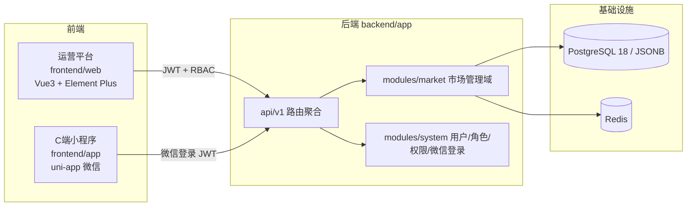
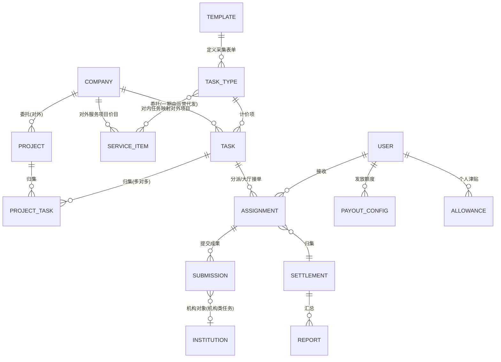
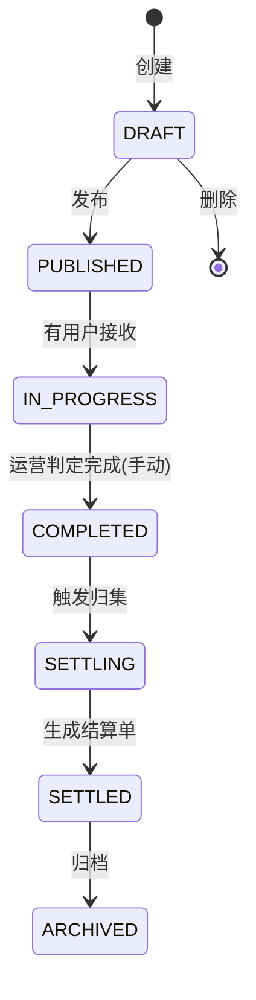
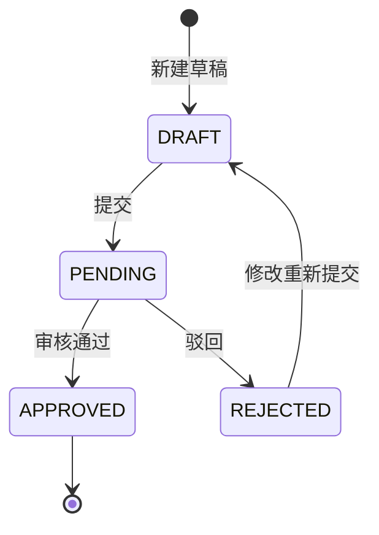
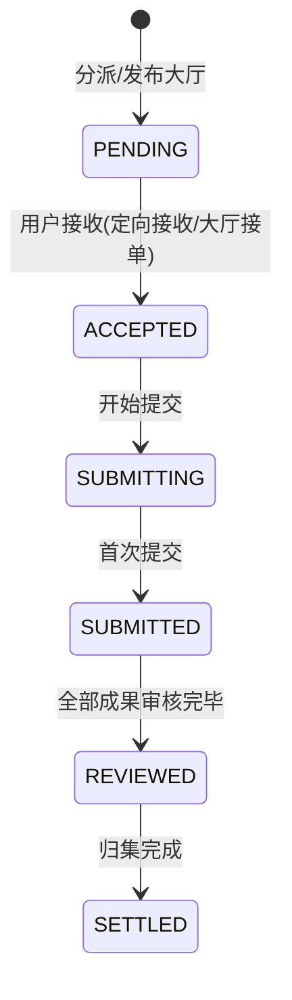
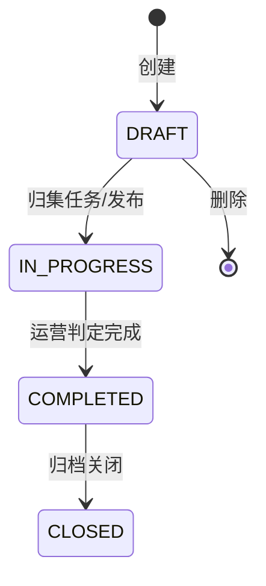

# 医药市场管理服务平台 —— 系统设计文档

| 项目 | 内容 |
|---|---|
| 版本 | v1.1（一期） |
| 日期 | 2026-10-23 |
| 关联文档 | `01-PRD-产品需求文档.md`、`03-流程与状态流转.md` |

---

## 1. 总体架构

一期复用现有 FastapiAdmin 三端架构，新增一个业务域包 `market`。



### 1.1 技术选型（全部复用现状，不新增依赖）

| 层 | 选型 |
|---|---|
| 后端 | FastAPI + SQLAlchemy(async) + Pydantic v2 |
| 认证 | JWT（运营端账号密码 / 小程序微信登录 `wx_mini_service`） |
| 存储 | PostgreSQL 18（JSONB 存表单异构数据）+ Redis（缓存/锁/订阅） |
| 运营前端 | Vue3 + Element Plus + Tailwind（`frontend/web`） |
| 小程序 | uni-app + 微信（`frontend/app`，alova 请求） |
| 图表/表单 | 动态表单由模板 JSON Schema 驱动 |

---

## 2. 模块与目录规划

新增域包 `backend/app/modules/market/`，按现有「域包/模块/{controller,service,crud,model,schema}.py」规范组织：

```
backend/app/modules/market/
├── company/          # 医药公司主数据
├── institution/      # 机构主数据（医院/药店/商业公司）
├── template/         # 采集模板（9 类，form_schema 的宿主）
├── project/          # 项目（对外）+ 项目-任务归集（多对多）
├── task/             # 任务类型（44 计价项）+ 任务（周期/定额分类）
├── assignment/       # 任务分派/接收
├── submission/       # 成果提交（含审核）
├── settlement/       # 归集结算（结算单）
├── report/           # 报告打包
├── service_item/     # 对外服务项目价目（37 项，甲方结算口径）
└── payout/           # 每月发放额度 + 个人任务津贴
```

路由前缀：`/api/v1/market/**`（加入 `api/v1/routers.py` 的 `DOMAIN_CONTROLLERS`）。

---

## 3. 数据模型

### 3.1 ER 总览



### 3.2 核心表设计

> 约定：主键 `id UUID`；审计字段复用现有 `UserMixin`（`created_id/updated_id/deleted_id` + 时间）；异构采集数据用 JSONB。

#### `market_template`（采集模板，form_schema 宿主）

> 对应素材中一个**采集工作簿**（如「等级医院管理采集模板」），定义**采集表单结构**。与「任务类型（计价项）」是 1:N——一个模板下含多个计价项，共享同一套表单结构（或按采集对象拆多个表单）。**form_schema 挂在本层，不再挂在每个计价项上。**

| 字段 | 类型 | 说明 |
|---|---|---|
| code | varchar | 模板唯一编码，如 `grade_hospital_manage` |
| name | varchar | 模板名（如「等级医院管理采集模板」） |
| scope | varchar | 覆盖的计价项任务号范围，如 `5-17` |
| form_schema | jsonb | 采集字段 JSON Schema（驱动动态表单，支持 `section`/`table`） |

#### `market_task_type`（任务类型 = 对内计价项）

> 对应结算单中的一行（任务号 1–44）。它是**对内计价项**，绑定一个采集模板，用三级 `service_type/service_item/service_task` 表达服务归属。

| 字段 | 类型 | 说明 |
|---|---|---|
| code | varchar | 唯一编码，如 `hospital_delivery` |
| name | varchar | 任务类型名（如「等级医院管理-配送协调」） |
| task_no | smallint | 任务号（1–44，对应结算单「任务序号」） |
| template_id | uuid FK | 所属采集模板 `market_template.id` |
| service_type / service_item / service_task | varchar | 结算单三级：类型/项目/任务 |
| unit | varchar | 计价单位（家/月、份、次） |
| default_price | numeric | 默认单价 |
| default_kind | varchar | 默认任务分类：`periodic` 周期性 / `quota` 定额（创建任务时可覆盖） |
| required | bool | 是否必选 |
| min_qty | int | 必选最低执行数量（如「1家起」的 1），可空 |
| max_per_period | int | 周期内执行次数上限（如宣传服务「每月不超过 20 次」），可空 |
| exec_standard | text | 执行标准（如「完成任意 2 项及以上工作视为达成」） |
| dedup_rule | varchar | 去重约束（如「单个医务人员单月单项目只能调研一次」），可空 |

#### `market_project`（项目，对外）

| 字段 | 类型 | 说明 |
|---|---|---|
| code | varchar | 唯一编码 |
| name | varchar | 项目名 |
| company_id | uuid FK | 委托方（医药公司） |
| amount | numeric | 项目对外金额（与任务金额不挂钩） |
| period | varchar | 周期 |
| status | varchar | 草稿/进行中/已完成/已关闭 |
| publisher_id | uuid | 发布人 |

#### `market_project_task`（项目-任务归集，多对多）

| 字段 | 类型 | 说明 |
|---|---|---|
| project_id | uuid FK | 项目 |
| task_id | uuid FK | 任务 |
| （唯一约束） | — | `unique(project_id, task_id)` |

#### `market_task`（任务，对内）

| 字段 | 类型 | 说明 |
|---|---|---|
| task_no | varchar | 运行期任务流水号（唯一，如 `TK202610-001`） |
| task_type_id | uuid FK | 任务类型（计价项）`market_task_type.id`（间接绑定采集模板） |
| task_kind | varchar | 任务分类：`periodic` 周期性 / `quota` 定额 |
| period | varchar | 周期（如 `2026-10`，默认自然月） |
| exec_time_start / exec_time_end | timestamptz | 定额任务的限定时间范围（周期任务可空） |
| unit_price | numeric | 本期单价（可覆盖模板默认）；任务金额仅对内 |
| exec_qty | int | 执行数量（定额任务为限量；周期任务为空/不限） |
| assign_mode | varchar | 分配方式：`direct` 定向分派 / `open` 公开大厅 |
| status | varchar | 见 §4 状态机（完成由运营判定） |
| completed_by / completed_at | uuid / timestamptz | 完成判定人/时间（运营） |
| publisher_id | uuid | 发布人 |
| published_at | timestamptz | 发布时间（完成由运营判定，不再以截止时间自动触发归集） |

#### `market_assignment`（任务分派/接收）

| 字段 | 类型 | 说明 |
|---|---|---|
| task_id | uuid FK | 任务 |
| user_id | uuid FK | C 端用户 |
| source | varchar | 来源：`assigned` 运营分派 / `claimed` 大厅接单 |
| status | varchar | 待接收/已接收/进行中/已提交/已审核/已结算 |
| accepted_at / submitted_at | timestamptz | 接收/提交时间 |

> 金额按「成果」结算，分派层**不预占金额、不限额**（不再记录 `assign_amount`）。

#### `market_submission`（成果提交）

| 字段 | 类型 | 说明 |
|---|---|---|
| assignment_id | uuid FK | 归属任务实例 |
| user_id | uuid FK | 提交人 |
| subject_type | varchar | 采集对象类型：`institution` 机构 / `staff` 医务人员/店员 / `patient` 患者 |
| institution_id | uuid FK | 对象机构（仅 `subject_type=institution` 时非空） |
| subject_name | varchar | 对象名称/昵称（`staff`/`patient` 时必填，如受访医务人员昵称、患者编号） |
| region | varchar | 区域 |
| archive_no | varchar | 开发档案编号 |
| period | varchar | 提交月份（用于周期性任务「单月一次」约束） |
| form_data | jsonb | 采集表单数据（异构，含多行子表） |
| status | varchar | 草稿/待审核/通过/驳回 |
| version | int | 版本（驳回重提 +1） |
| reviewer_id / review_comment / reviewed_at | — | 审核信息 |
| ai_check_status / ai_check_result | varchar / jsonb | AI 智能体检查（预留，一期为空） |

> 周期性任务：`unique(user_id, task_id, period)`（单用户单月仅一次有效提交）；定额任务无此约束、可单月重复提交。

#### `market_settlement` / `market_settlement_item`（结算单）

| 表 | 关键字段 | 说明 |
|---|---|---|
| settlement | task_id, user_id, qty, payable_amount, status | 归集头 |
| settlement_item | settlement_id, service_type/item/task, unit, price, qty, amount | 结算明细（对应附件结算单行） |

#### `market_service_item`（对外服务项目价目）

> 对应「服务项目结算单」（甲方口径）的一行（服务项目号 1–37）。与对内任务价目**独立**，金额不挂钩。两级结构（类型/项目），无「任务」三级。

| 字段 | 类型 | 说明 |
|---|---|---|
| code | varchar | 唯一编码 |
| service_no | smallint | 服务项目号（1–37） |
| name | varchar | 服务项目名（如「等级医院用药数据收集」） |
| service_type / service_item | varchar | 对外两级：类型/项目 |
| unit | varchar | 计费单位 |
| price | numeric | 对外单价 |
| company_id | uuid FK | 委托方（医药公司） |

#### `market_service_item_task`（对内任务 ↔ 对外服务项目映射，多对多）

| 字段 | 类型 | 说明 |
|---|---|---|
| service_item_id | uuid FK | 对外服务项目 |
| task_type_id | uuid FK | 对内任务类型（计价项） |
| （唯一约束） | — | `unique(service_item_id, task_type_id)` |

#### `market_report`（分析报告）

> 按**服务项目/任务类型 × 周期**生成，每个服务项目一份独立报告（对应素材中的分析报告 pptx），非「按医药公司汇总一份」。

| 字段 | 类型 | 说明 |
|---|---|---|
| company_id | uuid FK | 医药公司 |
| service_item_id | uuid FK | 对外服务项目（报告针对的服务项目），可空 |
| task_type_id | uuid FK | 对内任务类型（报告针对的任务类型），可空 |
| period | varchar | 周期 |
| summary | jsonb | 该服务项目/任务类型的完成量/金额汇总 |
| attachment | varchar | 报告附件（pptx/pdf 打包路径） |
| status | varchar | 草稿/已生成/已提交 |

#### `market_payout_config` / `market_allowance` / `market_allowance_detail`（发放额度与津贴）

| 表 | 关键字段 | 说明 |
|---|---|---|
| payout_config | user_id(nullable=全局默认), period, payout_limit, enabled | 每月发放额度（默认 20000，运营可调 10000/20000） |
| allowance | user_id, balance, updated_at | 个人任务津贴账户（累计未发放金额） |
| allowance_detail | user_id, from_period, amount, status, paid_at | 津贴明细（来源月份/金额/待发/已发） |

### 3.3 `form_schema` 结构规范

> 采集表单由 `market_template.form_schema` 权威定义，前端只对齐。真实采集表（来自素材模板）是「分节 + 键值对 + 多行子表 + 图片/附件」混合结构，故字段需支持三种承载形态：

| 形态 | 表达 | 示例 |
|---|---|---|
| 键值对字段 | 单字段（`FormSchemaField`） | 区域、医院名称、产品规格 |
| 分节 `section` | `type: section`，仅作分组标题 | 「一、执行信息」「二、调研信息」「三、证明材料」 |
| 多行子表 `table` | `type: table`，含 `columns[]` 子列定义 | 配送协调明细（产品/批号/配送数量/配送时间/配送商业）、进销存明细、票款往来 |

`FormSchemaField` 在现有基础上增加：`section`（所属分节，可空）、`type: table`（多行子表，`columns` 为子字段数组）。图片/附件沿用 `image` / `file`（对应素材中的 `=DISPIMG` 打卡照片、合同/入库单附件）。

---

## 4. 状态机

### 4.1 任务状态



> 任务「完成」由运营人员手动判定（任务可归集到多个项目，不依赖自动截止）。

### 4.2 成果状态



### 4.3 分派状态



> 周期性任务：单用户单月仅一次 `SUBMITTED`；定额任务：单月可多次 `SUBMITTING → SUBMITTED` 循环。

### 4.4 项目状态



---

## 5. 发放算法（重点）

### 5.1 数据结构依赖

- `payout_config`：每月发放额度 `P`（默认 20000）
- `allowance`：个人任务津贴余额 `balance`
- `settlement`：本月归集应发金额 `payable`（无上限）

### 5.2 算法

**接收/提交任务时**：不限额、不限单量，仅按任务分类做提交约束：

```
周期性任务：单用户单月仅一次提交（unique(user_id, task_id, period)）
定额任务：单月可重复提交，受任务总执行数量限量约束
```

**归集结算时**（发放封顶 + 津贴累计）：

```
本月应发 payable = Σ(通过成果金额)            # 无上限
待发 pending = payable + balance(上月津贴余额)
本月实发 paid = min(pending, P)               # P 为每月发放额度
本月津贴余额 balance' = max(0, pending - P)   # 未发放部分累计
```

**下月发放**：

```
下月待发 = 下月 payable + 本月津贴余额 balance'
```

### 5.3 示例（发放额度 2 万，本月应发 3 万，上月津贴 0）

| 阶段 | 计算 | 结果 |
|---|---|---|
| 归集 | payable = 3 万，pending = 3 + 0 = 3 万 | 应发 3 万 |
| 发放 | paid = min(3 万, 2 万) | 实发 2 万 |
| 津贴 | balance' = 3 - 2 = 1 万 | 滚入下月 |
| 下月 | 下月 payable + 1 万 | 优先发放 |

### 5.4 一期落地

- 一期只写 `payable / paid / balance`，**不打款**。
- 结算单预留 `paid_amount / pay_status` 字段，二期支付时写入。

---

## 6. API 设计（摘要）

| 端 | 方法 | 路径 | 说明 | 权限 |
|---|---|---|---|---|
| 运营 | POST | `/api/v1/market/projects` | 创建项目（对外） | market:project:add |
| 运营 | POST | `/api/v1/market/projects/{id}/tasks` | 任务归集到项目（多对多） | market:project:edit |
| 运营 | POST | `/api/v1/market/tasks` | 创建任务（周期/定额分类） | market:task:add |
| 运营 | POST | `/api/v1/market/tasks/{id}/publish` | 发布任务（按 assign_mode 进公开大厅/定向） | market:task:publish |
| 运营 | POST | `/api/v1/market/tasks/{id}/complete` | 判定任务完成（运营手动） | market:task:complete |
| 运营 | POST | `/api/v1/market/assignments` | 定向分派任务 | market:task:assign |
| 运营 | GET | `/api/v1/market/submissions?task_id=` | 审核列表 | market:submission:list |
| 运营 | POST | `/api/v1/market/submissions/{id}/review` | 通过/驳回 | market:submission:review |
| 运营 | POST | `/api/v1/market/tasks/{id}/settle` | 触发归集结算 | market:settlement:run |
| 运营 | POST | `/api/v1/market/reports` | 生成报告 | market:report:add |
| 运营 | PUT | `/api/v1/market/payout/{user_id}` | 配置每月发放额度（默认 2 万） | market:payout:edit |
| 小程序 | GET | `/api/v1/market/mini/tasks` | 任务大厅（分页/平铺） | 登录 + C 端成员 |
| 小程序 | GET | `/api/v1/market/mini/tasks/grouped` | 任务大厅（按项目分组） | 同上 |
| 小程序 | GET | `/api/v1/market/mini/tasks/{id}` | 任务单详情 | 同上 |
| 小程序 | POST | `/api/v1/market/mini/tasks/{id}/claim` | 大厅接单 | 同上 |
| 小程序 | GET | `/api/v1/market/mini/assignments` | 我的任务（`status` 过滤） | 同上 |
| 小程序 | GET | `/api/v1/market/mini/assignments/grouped` | 我的任务（按项目分组） | 同上 |
| 小程序 | GET | `/api/v1/market/mini/assignments/{id}` | 分派单详情 | 同上 |
| 小程序 | POST | `/api/v1/market/mini/assignments/{id}/accept` | 接收任务 | 同上 |
| 小程序 | GET | `/api/v1/market/mini/task-stats` | 我的待办计数（Tab/状态 Tab 角标） | 同上 |
| 小程序 | GET | `/api/v1/market/mini/week-progress` | 本周进度（工作台进度带：截止日在本周的分派交付情况） | 同上 |
| 小程序 | GET | `/api/v1/market/mini/submissions` | 我的成果列表 | 同上 |
| 小程序 | POST | `/api/v1/market/mini/submissions` | 提交成果 | 同上 |
| 小程序 | GET | `/api/v1/market/mini/submissions/{id}` | 我的成果详情（驳回重提回填，仅本人） | 同上 |
| 小程序 | PUT | `/api/v1/market/mini/submissions/{id}` | 修改成果（驳回重提） | 同上 |
| 小程序 | GET | `/api/v1/market/mini/payout` | 我的发放：本月应发/额度/津贴余额/明细 | 同上 |
| 小程序 | GET | `/api/v1/market/mini/products/search` | 产品检索（提交成果自动填充） | 同上 |
| 小程序 | POST | `/api/v1/market/mini/upload` | 成果附件上传 | 同上 |
| 小程序 | GET | `/api/v1/market/mini/institutions` | 机构列表（成果选择对象机构） | 同上 |
| 小程序 | GET/POST | `/api/v1/system/ticket/mini/feedback` | 意见反馈（列表/提交，仅本人数据） | 登录用户 |
| 小程序 | GET | `/api/v1/system/notice/available?limit=50` | 已发布公告（`status=1`，公开内容） | 登录用户 |

> 完整接口见代码实现，遵循现有 `controller/service/crud/model/schema` 五件套与统一响应结构。
>
> **C 端（小程序）接口的三个口径**：
> 1. `/market/mini/*` 用 `require_market_member`：要求登录且**有启用的 C 端成员档案**（首次访问自动建档，SAVEPOINT 兜并发），不看角色；不要求运营端 RBAC 权限码。数据面由 Service 强制收敛到本人，越权按「不存在」处理。
> 2. 公开内容（公告）显式绕过 `CRUDBase` 的数据权限：非超管会被自动叠加 `created_id = 当前用户`，直接用 `page()` 会导致 C 端一条都看不到。
> 3. 公告状态以模型注释为准（`0:草稿 1:已发布 2:已归档`），`/notice/available` 只返回 `status=1`，倒序，`limit` 可配。

---

## 6.1 C 端（小程序）信息架构

| 层级 | 内容 | 可见性 |
|---|---|---|
| TabBar | 首页（默认落地页）/ 任务大厅 / 工作台 / 我的；「工作台」带待办角标（待接收 + 进行中 + 被驳回成果） | 全角色一致 |
| 首页 | **只讲 C 端自己的事**：今日工作单（日期 + 今天要交几件 + 待接收/待提交/被驳回 + 最晚截止，三个数字可点进工作台对应筛选）、滚动公告条、本周按时完成、本月收益（应发 + 额度进度条）、我的成果（待审核/已通过/被驳回，可点）、接下来要交的 2 条、最新任务 3 条 | 全角色 |
| 工作台 | 渐变 Hero（今天要处理 N 件 / 本周按时完成 done of due，无到期任务显示「暂无」）+ 任务/成果两层：任务（全部/待接收/进行中/已提交/已审核，默认「进行中」）与成果（全部/待审核/已通过/已驳回，含驳回原因与修改重提） | 全角色 |
| 任务大厅 | 最新公告条、关键词搜索、按项目筛选、任务卡（C 端显示名 + 项目/分类/模板链路 + 单价·单位 + 截止倒计时）→ 任务详情 → 详情内接单 | 全角色 |
| 任务详情 | 执行标准、执行要求、需填字段预览（按采集分节）、计价口径；底部固定「立即接单」 | 全角色 |
| 我的 | 身份行（昵称/脱敏手机号/执行用户）+ 收益卡（应发 + 额度进度）+ 我的服务（意见反馈/通知公告）+ 账号（个人资料/账户密码/设置/关于/退出登录） | 全角色 |
| 运营仪表盘 / 全部功能 | 运营仪表盘（注册数/在线数/登录趋势）、工单、AI 助手、AI 模型、公告写操作 | **仅超管**（`is_superuser`），入口在「我的 → 账号」内 |

设计要点（改版理由）：

- 首页原先复用的是运营仪表盘（注册用户/在线人数/登录趋势），C 端用户看到的是平台数据；现在首页只放「今天要交什么」与「这个月能拿多少」，运营数据下沉到超管的「运营仪表盘」。
- 待办数字全站同口径：首页今日工作单、工作台进度带、TabBar 角标都来自 `task-stats`（待接收 + 进行中 + 被驳回成果）。
- 本周进度以**任务截止日期落在本周**为准（`week-progress`），而不是成果提交时间——迟交仍属于本周该交的活；本周无到期任务时不画进度条，直接显示「暂无」。
- 入口可见性唯一来源：`frontend/app/src/constants/nav.ts` + `composables/useAccess.ts`；页面全部保留，只隐藏入口，真实越权由后端拦截。
- 头部：四个 Tab 页用 `navigationStyle: custom`，由页面自己画头部（首页/工作台是通栏渐变 Hero，任务大厅是标题 + 搜索），不再有原生导航条与 12px 白缝；H5 宽屏下内容限宽 560px 居中、渐变仍铺满整屏。
- 跨 Tab 定位：首页数字跳工作台走一次性信号 `useWorkDeskFilter`（`switchTab` 不支持 query）；`useTabbarActive` 直接写 TabBar active 状态，保证跳转后底栏高亮跟着走。
- TabBar 页必须在主包：`home` / `work-desk` / `task-hall` / `mine` 均在 `src/pages/`（`task-hall`、`work-desk`、`task-detail` 位于 `src/pages/market/`）。
- 收益卡口径：本月应发 = `market_settlement.payable_amount` 按 `period` 汇总（`PayoutService.period_payable`，不新开接口，`/mini/payout` 直接返回 `payable`）。
- 无单价任务（`item/template config` 都没有 `price`）统一显示「面议」，且不再显示单位，避免「面议 /元/份」的半截文案。

---

## 7. 二期预留设计

| 预留点 | 一期做法 | 二期扩展 |
|---|---|---|
| 发布者抽象 | `task.publisher_id` 固定为运营用户 | 抽象 `publisher` 为「运营 / 医药公司」，增外部租户 |
| 项目对外结算 | 项目仅记录对外金额、不与任务金额挂钩 | 医药公司平台在线对项目验收/结算 |
| 执行主体抽象 | `assignment.user_id` 指向个人 | 增加 `org_id`，个人/团队/公司统一为「执行主体」 |
| 组织内审核 | 仅运营端审核 | 增加组织层级审核流（`review` 多级） |
| 支付 | 结算单仅算金额 | 增 `paid_amount/pay_status` + 支付渠道 |
| 津贴支付 | 独立 `allowance` / `allowance_detail` 表 | 支付时消费津贴记录 |
| AI 智能体检查 | 提交走规则校验，预留 `ai_check_status/ai_check_result` + `checker` 抽象 | 接入智能体做真实性/合理性/异常识别 |
