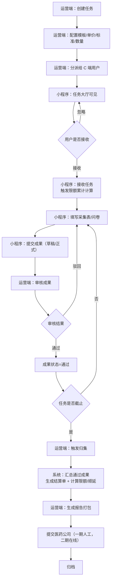
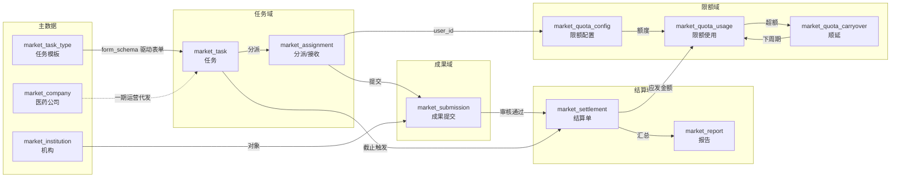
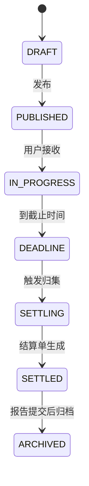
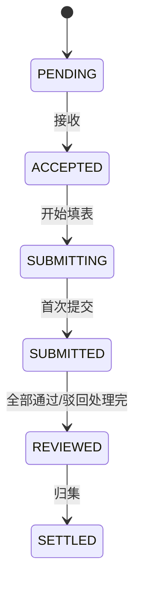
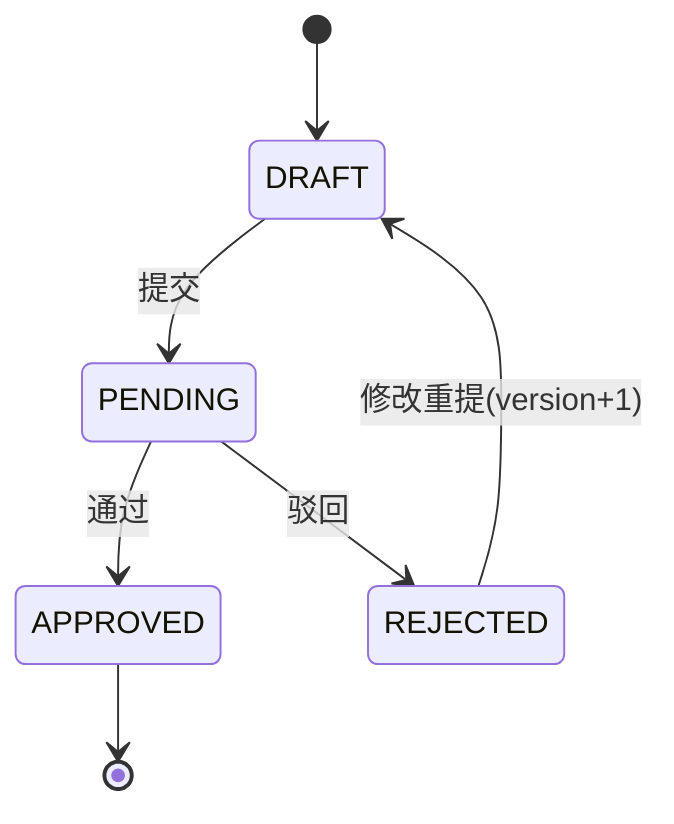
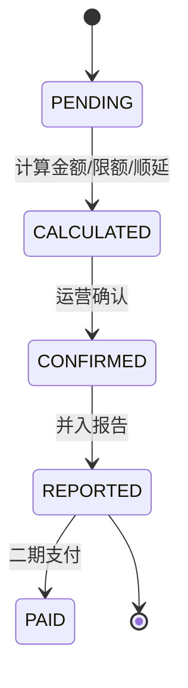
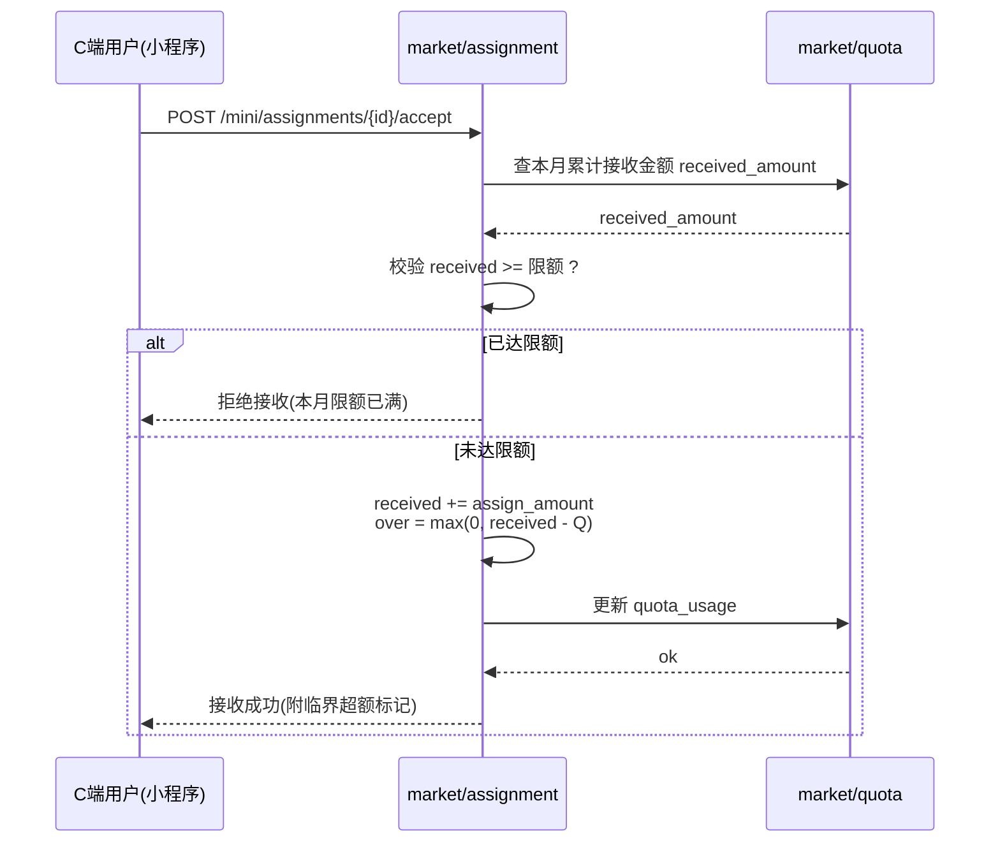
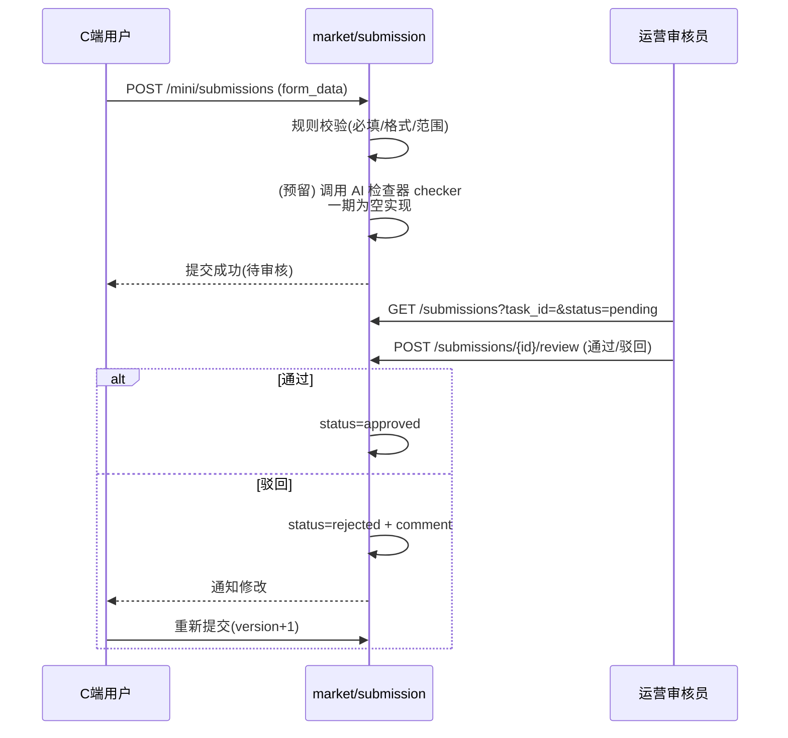
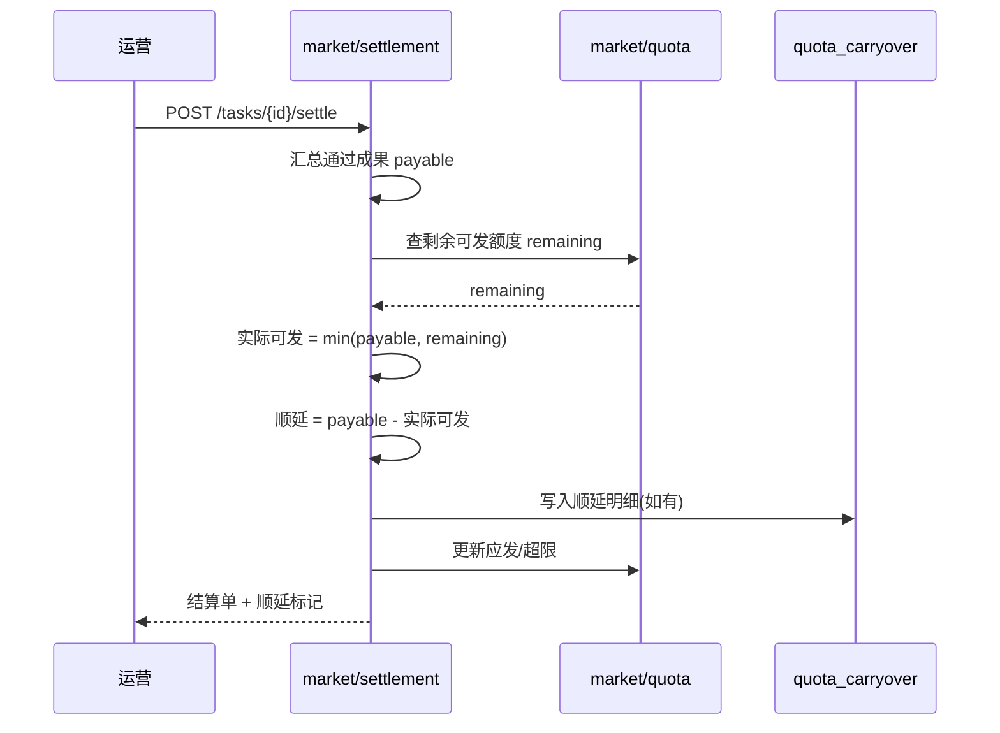
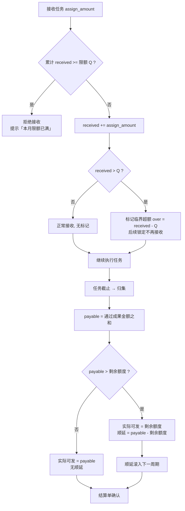

# 医药市场管理服务平台 —— 流程与状态流转文档

| 项目 | 内容 |
|---|---|
| 版本 | v1.0（一期） |
| 日期 | 2026-10-22 |
| 关联文档 | `01-PRD-产品需求文档.md`、`02-系统设计文档.md` |

---

## 1. 任务流转总流程图（端到端）

---

## 2. 数据流转图

---

## 3. 状态流转汇总

### 3.1 任务状态

### 3.2 分派/接收状态

### 3.3 成果状态

### 3.4 结算单状态

---

## 4. 关键时序图

### 4.1 接收任务 + 限额累计

### 4.2 成果提交与审核

### 4.3 归集结算 + 顺延

---

## 5. 限额计算流程图（规则）

---

## 6. 一期 vs 二期 流程差异

| 环节 | 一期 | 二期 |
|---|---|---|
| 任务来源 | 运营端代发 | 医药公司平台自助发布 |
| 执行主体 | 个人用户 | 个人 / 团队 / 公司 |
| 审核 | 运营端单级审核 | 组织内审核 + 运营复审 |
| 结算 | 计算金额（不打款） | 实发 + 顺延支付 |
| 报告提交 | 导出打包（人工/邮件） | 医药公司平台在线交付 |
