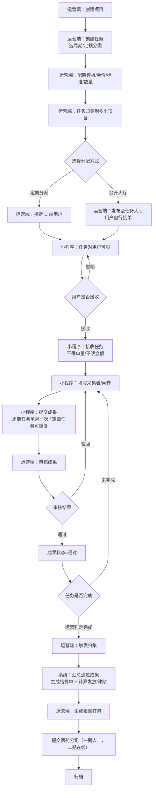
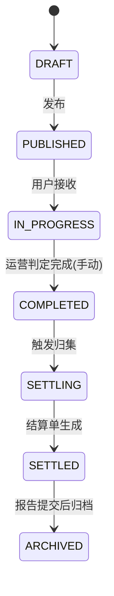
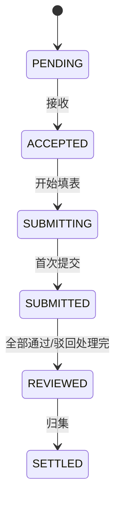
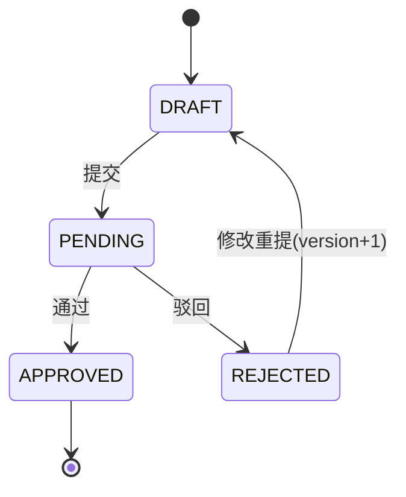
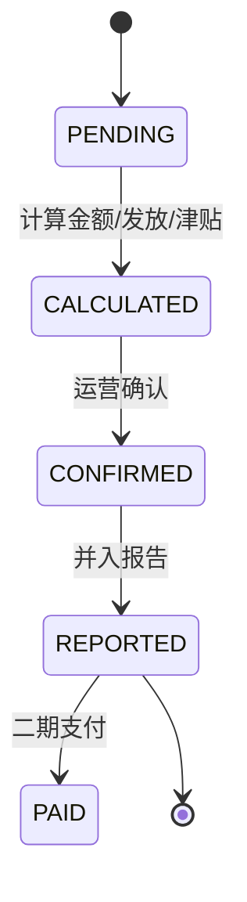
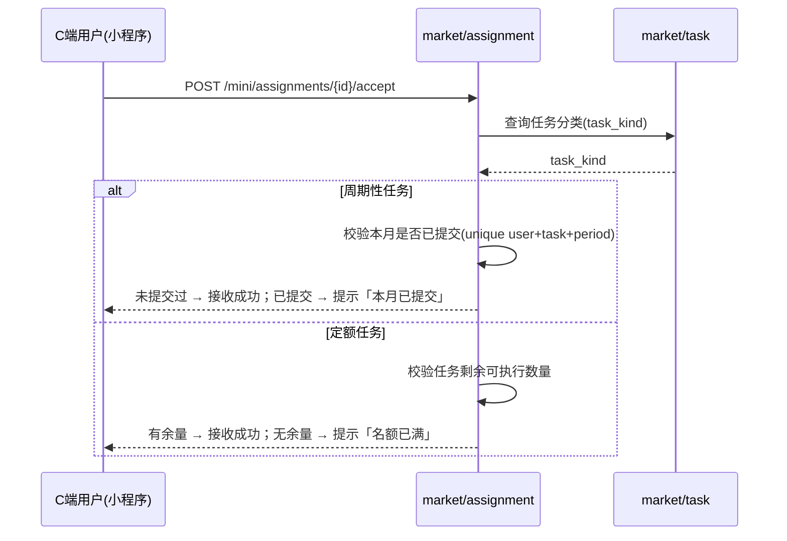
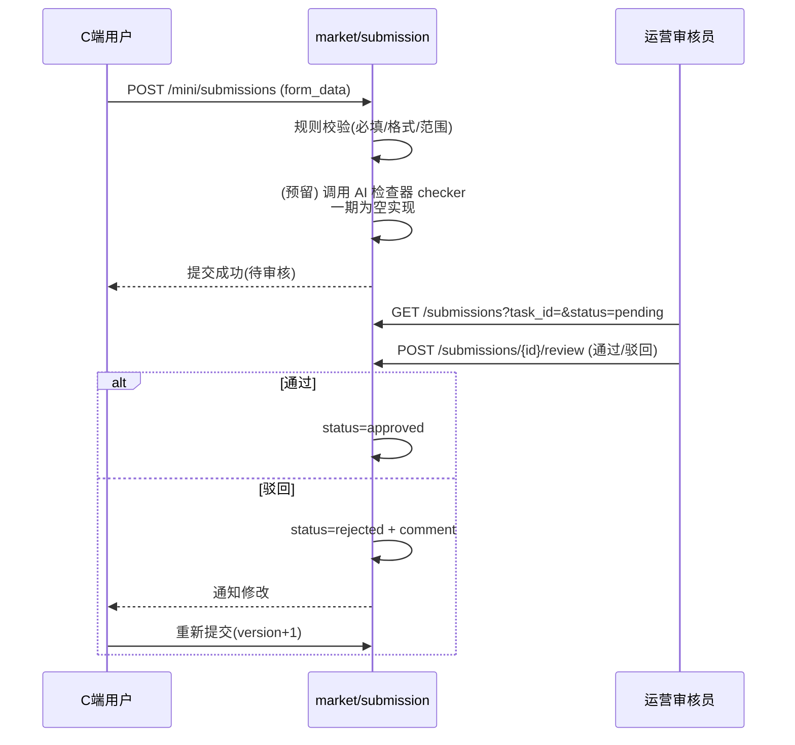
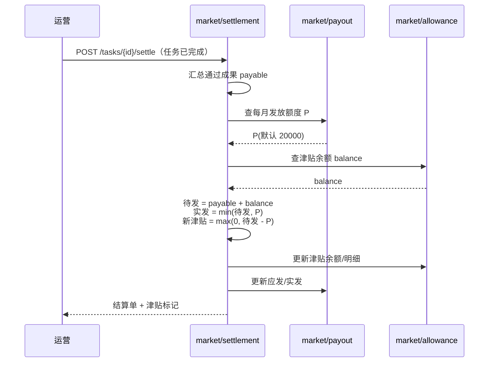
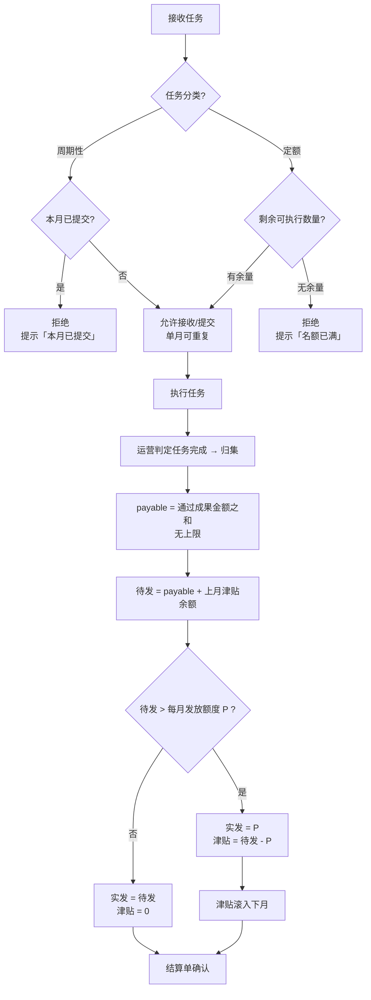

# 医药市场管理服务平台 —— 流程与状态流转文档

| 项目 | 内容 |
|---|---|
| 版本 | v1.1（一期） |
| 日期 | 2026-10-23 |
| 关联文档 | `01-PRD-产品需求文档.md`、`02-系统设计文档.md` |

---

## 1. 任务流转总流程图（端到端）



---

## 2. 数据流转图

```mermaid
flowchart LR
    subgraph 主数据
        TY[market_task_type<br/>任务模板]
        CO[market_company<br/>医药公司]
        INS[market_institution<br/>机构]
    end
    subgraph 项目域
        PJ[market_project<br/>项目(对外)]
        PT[market_project_task<br/>项目-任务归集]
    end
    subgraph 任务域
        TK[market_task<br/>任务(对内)]
        AS[market_assignment<br/>分派/接收]
    end
    subgraph 成果域
        SB[market_submission<br/>成果提交]
    end
    subgraph 结算域
        ST[market_settlement<br/>结算单]
        RP[market_report<br/>报告]
    end
    subgraph 发放域
        PC[market_payout_config<br/>发放额度]
        AL[market_allowance<br/>个人津贴]
    end

    TY -->|form_schema 驱动表单| TK
    CO -->|委托(对外)| PJ
    CO -.->|一期运营代发| TK
    PJ -->|归集| PT
    TK -->|归集(多对多)| PT
    TK -->|分派| AS
    AS -->|提交| SB
    INS -->|对象| SB
    SB -->|审核通过| ST
    TK -->|运营判定完成后触发| ST
    ST -->|汇总| RP
    PC -->|额度| AL
    ST -->|应发金额| AL
    AL -->|超额累计津贴| AL
```

---

## 3. 状态流转汇总

### 3.1 任务状态



### 3.2 分派/接收状态



> 周期性任务单用户单月仅一次 `SUBMITTED`；定额任务单月可多次 `SUBMITTING → SUBMITTED`。

### 3.3 成果状态



### 3.4 结算单状态



---

## 4. 关键时序图

### 4.1 接收任务（不限单量/不限金额）



### 4.2 成果提交与审核



### 4.3 归集结算 + 发放 + 津贴



---

## 5. 发放计算流程图（规则）



---

## 6. 一期 vs 二期 流程差异

| 环节 | 一期 | 二期 |
|---|---|---|
| 任务来源 | 运营端代发 | 医药公司平台自助发布 |
| 项目 | 项目对外、任务对内，多对多归集，金额不挂钩 | 医药公司平台在线项目验收/结算 |
| 任务完成 | 运营手动判定完成 | 按项目维度自动/协作判定 |
| 执行主体 | 个人用户 | 个人 / 团队 / 公司 |
| 审核 | 运营端单级审核 | 组织内审核 + 运营复审 |
| 结算 | 计算金额 + 发放额度/津贴（不打款） | 实发 + 津贴支付 |
| 报告提交 | 导出打包（人工/邮件） | 医药公司平台在线交付 |
