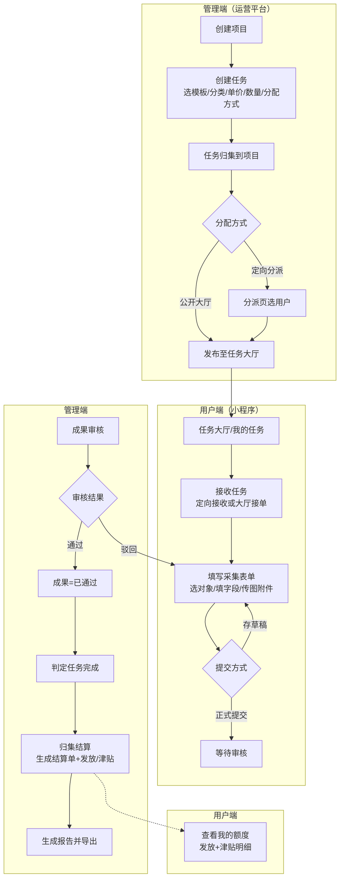
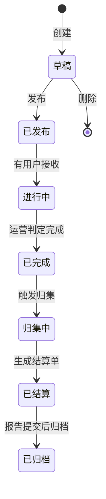
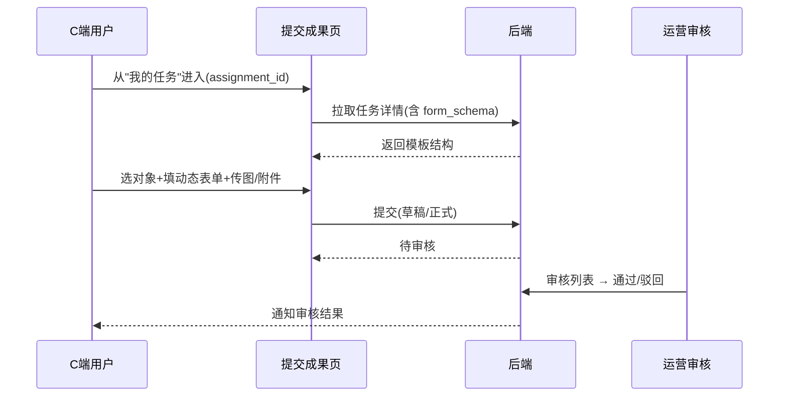

# 医药市场管理服务平台 —— 前端交互与视觉设计文档

| 项目 | 内容 |
|---|---|
| 版本 | v1.0（一期） |
| 日期 | 2026-10-23 |
| 关联文档 | `01-PRD-产品需求文档.md`、`02-系统设计文档.md`、`03-流程与状态流转.md` |
| 覆盖端 | `frontend/web`（运营平台/管理端，Vue3 + Element Plus + Tailwind v4）、`frontend/app`（C 端小程序，uni-app + wot-ui + UnoCSS presetWot） |

---

## 0. 一句话结论

两端「页面各自能跑、流程各自能走」，但**设计体系是两套、关键任务路径是断的**：管理端 10 个页面零跨页导航，状态流转被埋在行内「操作」下拉里；用户端靠 URL query 透传表单结构，状态 Tab 语义自相打架。本方案的目标是：**用一套共享语义令牌把两端视觉拉齐，用「状态流转时间线 + 页内引导」把隐式流程显性化，用「入口页/详情页/动作反馈」三件套把断层补上**。

---

## 1. 现状诊断（割裂感的 9 个来源）

> 每条都给出代码证据，作为整改的靶点，不是主观感受。

| # | 割裂点 | 证据 | 影响 |
|---|---|---|---|
| D1 | **管理端零跨页导航** | `frontend/web/src/views/module_market/` 下 10 个页面 `grep router.push / useRouter / navigateTo` 命中 **0** | 任务→分派→审核→归集→报告全链路是隐式的，运营不知道"下一步去哪、下一步该谁做" |
| D2 | **状态流转藏在下拉操作列** | `task/index.vue:120-133` 用 `if(row.status===...)` 决定「发布/判定完成/归集结算」按钮 | 状态机（DRAFT→…→ARCHIVED）不可见，用户靠记忆推断下一步 |
| D3 | **用户端 form_schema 走 URL 透传** | `my-task/index.vue:63-72` `encodeURIComponent(JSON.stringify(formSchema))` → `submission-form/index.vue:213-223` 解析 | 模板改了就陈旧；schema 大时超 URL 长度；无法承载即将上线的 section/table 结构 |
| D4 | **用户端状态 Tab 语义打架** | `my-task/index.vue:29-32` Tab 把「进行中」映射到 `ACCEPTED`，而 `:16-23` 状态图里 `ACCEPTED=已接收`、`SUBMITTING=进行中` | 同一页面内「进行中」对应两个枚举值 |
| D5 | **两端令牌是两套体系** | Web `--fa-*`+Tailwind；App `--wot-*`+`--drop-*`+`theme.json`+`primaryShades` 四份重复定义（见 `audit-uxui.md` P2-9） | 同一品牌两套颜色/字号/圆角，换主题两端不同步 |
| D6 | **状态色语义两端不一致** | 见 `audit-uxui.md` P2-8（工单 status Web 橙/灰 vs App 灰/蓝） | 同一个"进行中"两端颜色相反 |
| D7 | **列表卡片形态不统一（App 内）** | `task-hall/index.vue:85` 用 `wd-cell-group`，`my-task/index.vue:100` 用独立 `rounded-2 bg-white` 卡片 | 同 App 两个列表页两种长相 |
| D8 | **错误态系统性缺失** | `useTable`/`useListPage` 都暴露了 `error` 但页面一律 `catch { /* ignore */ }`（`audit-uxui.md` P1-3/P1-4） | 加载失败被渲染成"暂无数据"，用户分不清"没数据"与"挂了" |
| D9 | **空态不区分语义 + 术语不统一** | 空态固定"暂无数据"（P2-7）；"启用/停用" vs "禁用"、"公告/通知/通知公告"（P2-8） | 理解成本高，专业感打折 |

---

## 2. 设计原则

1. **一套语义，两套载体**：两端底层技术不同（Tailwind vs UnoCSS），但**语义令牌一一对应**——同一个"主色/成功/警示/危险/信息/边框/背景"语义，两端落到同一个 hex，前端只做映射不做第二份定义源。
2. **流程显性化**：把 03 文档里的状态机（任务/分派/成果/结算/项目）做成可见的「进度时间线 + 下一步动作按钮」，而不是散落在 if/else 里。
3. **入口即引导**：每个列表页的顶部给一句"当前处于流程哪一步、下一步做什么"的轻提示；空态是"邀请行动"而非"抱歉"。
4. **行动闭环**：每个动作按钮的文案 = 动作本身（"发布""接单""提交成果""通过"），动作后的 toast/跳转 = 同一动词的完成式（"已发布""已接单"），全流程用词不变。
5. **失败可恢复**：列表页区分「加载中 / 空 / 筛选无结果 / 加载失败」，失败必带重试；移动端区分「不存在」与「网络失败」。

---

## 3. 统一视觉规范（设计令牌）

### 3.1 品牌色与语义色（两端唯一真值源）

> 保留现有蓝色主基调（专业、可信，符合医药服务气质），收敛为**一套**语义令牌。Web 落地到 `--fa-*` / Tailwind `@theme`；App 落地到 `--wot-*`（删除 `--drop-*`/`theme.json`/`primaryShades` 三份重复定义，只留一份）。

| 令牌 | 语义 | Hex | 用途 |
|---|---|---|---|
| `color-primary` | 主色（品牌蓝） | `#4080FF` | 主按钮、进行中状态、链接、选中态 |
| `color-success` | 成功 | `#22C55E` | 已通过/已结算/已发布完成态 |
| `color-warning` | 警示 | `#F59E0B` | 待处理/待审核/进行中（动作型） |
| `color-danger` | 危险 | `#EF4444` | 驳回/删除/超限 |
| `color-info` | 中性 | `#64748B` | 草稿/归档/已关闭 |
| `color-bg` / `color-card` | 页面底 / 卡片 | `#F5F7FA` / `#FFFFFF` | 背景分层 |
| `color-text-main` / `-aux` / `-muted` | 文本三级 | `#1F2937` / `#64748B` / `#94A3B8` | 标题 / 正文 / 辅助 |
| `color-border` | 分隔线 | `#E5E7EB` | 卡片描边、表头线 |

**状态色语义统一规则（覆盖 D6）**：`进行中/待处理=warning 橙`、`已发布/已接收/已完成=primary 蓝`、`通过/结算/关闭=success 绿`、`驳回/超限/删除=danger 红`、`草稿/归档/停用=info 灰`。两端 `constants.ts`（Web）与 `StatusBadge`（App）共用这份映射，**不再各自写一份**。

### 3.2 字体与字号

| 端 | 正文字体 | 数字/编号 | 备注 |
|---|---|---|---|
| Web | 系统栈（PingFang SC / Microsoft YaHei） | 表内金额用等宽数字 `font-variant-numeric: tabular-nums` | 金额列右对齐、千分位 |
| App | 系统默认 | 金额 `¥` 前缀 + 两位小数 | 金额用 `wot-text-error-main` 突出 |

字号统一为 5 档，补齐缺失的 `14px` 档（见 P2-11）：

| 档 | 值 | 用途 |
|---|---|---|
| xs | 11px | 角标、辅助 |
| sm | 12px | 表内正文、时间 |
| **md** | **14px** | **正文（补 `--font-size-md`）** |
| lg | 16px | 卡片标题 |
| xl | 18px | 页面标题、金额 |

### 3.3 间距与圆角

- 间距走 4px 刻度（4/8/12/16/24/32），禁写任意 px（对应 P2-11 的 231 处硬编码）。
- 圆角统一 `--radius`（Web `--custom-radius`、App 对应 wot 圆角令牌）：卡片 `12px`、按钮/输入 `6px`、弹层 `8px`。禁写 `border-radius: 6px/8px/4px` 固定值，保证用户可调圆角时全跟随。

### 3.4 动效

- 全局 `motion` 取「subtle」档：只保留两类动效——**动作反馈**（按钮按压、下拉刷新、loading）与**状态切换过渡**（150–300ms）。
- 不使用页面载入的滚动 reveal / 装饰性动画；尊重 `prefers-reduced-motion`。

---

## 4. 统一组件与交互反馈

### 4.1 两端组件映射（同一语义，同一套交互）

| 语义 | Web（Element Plus + Fa 组件） | App（wot-ui） | 交互约定 |
|---|---|---|---|
| 列表 | `FaTable` | 卡片列表 | 统一支持：骨架屏 → 加载态 → 空态/错误态 → 数据 |
| 状态标签 | `FaStatusTag` | `StatusBadge` | **共用同一份 status→色/文案映射**（见 §3.1） |
| 危险操作确认 | `useConfirm`（统一 `type:warning`） | `globalDialog.confirm`（收敛掉 `uni.showModal`，P2-6） | 标题 + 影响描述 + 「确认/取消」 |
| 表单 | `FaForm` + `rules` | `wd-form` | 字段级即时校验 + 提交中禁用防重复 |
| 空态 | `ElResult`/`FaTable.empty` | `wd-empty` | 区分「空 / 筛选无结果 / 失败」三态（见 §7） |
| 错误态 + 重试 | `FaTable` 增 `error`+`@retry` prop | 新增 `ErrorState` 组件 | 失败必带重试，禁止静默 `catch` |
| 分页 | 页码分页 | 触底加载 + 下拉刷新 | 各自平台习惯，但「到底提示」两端都要有 |

### 4.2 通用交互反馈契约（两端一致）

| 场景 | 反馈 |
|---|---|
| 列表加载中 | 骨架屏（首次）/ 行内 loading（增量） |
| 列表加载失败 | 错误态块 + 「重试」按钮（**禁止把失败当空态**） |
| 动作成功 | toast「已<动作>」（如"已发布""已接单""已提交"）+ 状态即时刷新 |
| 动作失败 | toast「<原因>，请重试」，**保留用户已填内容不丢失** |
| 危险操作 | 二次确认，文案写清"影响什么" |
| 表单校验失败 | 字段旁红字 + 定位到第一个错误字段 |

---

## 5. 两端页面结构说明

### 5.1 管理端（`frontend/web`，运营平台）

页面层级 = 「市场管理」一级菜单 → 8 个业务页 + 2 个主数据页。**新增跨页导航后**，每个页面的职责与出入口如下：

| 页面 | 路由 | 职责 | 入口（从哪来） | 出口（去哪） |
|---|---|---|---|---|
| 项目 | `/market/project` | 对外交付单元，任务归集 | 市场管理菜单 | 任务（"归集项目"） |
| 任务 | `/market/task` | 对内任务发布/完成/归集（**流程枢纽**） | 项目、菜单 | 分派（定向）、审核、结算 |
| 任务类型 | `/market/task-type` | 计价项维护（绑定模板） | 任务（选类型） | 模板（查看表单） |
| 采集模板 | `/market/template`（新增） | 表单结构宿主 | 任务类型 | — |
| 分派 | `/market/assignment` | 定向分派/大厅发布 | 任务（"分派"按钮带 task_id 跳转） | 任务 |
| 成果审核 | `/market/submission` | 通过/驳回 | 任务（"审核"）、菜单 | 结算、报告 |
| 结算 | `/market/settlement` | 结算单查看/确认 | 任务（"归集结算"）、审核 | 报告、发放 |
| 报告 | `/market/report` | 打包生成/导出 | 结算、菜单 | — |
| 发放 | `/market/payout` | 每月额度配置 | 菜单 | — |
| 医药公司 / 机构 | `/market/company` `/market/institution` | 主数据 | 菜单 | — |

> 关键变化：任务页从"只有 CRUD"升级为**流程枢纽**，行内增加「分派 / 审核 / 归集结算」等**跳转型**动作（带目标 id 到对应页并预填筛选），替代现在的纯 API 调用（D1）。

### 5.2 用户端（`frontend/app`，C 端小程序）

底部 TabBar 3 个 + 市场域 4 个页面：

| 页面 | 路由 | 职责 | 入口 | 出口 |
|---|---|---|---|---|
| 工作台 | `pages/work/index` | 入口页（市场域分组） | TabBar | 任务大厅 / 我的任务 / 我的额度 |
| 任务大厅 | `subPages/module_market/task-hall` | 公开任务浏览 + 接单 | 工作台 | 我的任务（接单后） |
| 我的任务 | `subPages/module_market/my-task` | 已接/定向任务 + 提交成果 | 工作台、任务大厅 | 提交成果 |
| 提交成果 | `subPages/module_market/submission-form` | 动态采集表单 | 我的任务（**改走 assignment_id 拉取模板，不再 URL 透传 schema**，D3） | 我的任务（返回刷新） |
| 我的额度 | `subPages/module_market/my-earnings` | 发放/津贴明细 | 工作台 | — |

> 关键变化：① `my-task → submission-form` 只传 `assignment_id`，表单页用 `getAssignment(assignment_id)` 现取 `task.task_type.form_schema`（消除 D3）；② 状态 Tab 改为与后端 `AssignmentStatus` 一致的 5 档：全部/待接收/已接收/已提交/已审核/已结算，修正 `ACCEPTED↔SUBMITTING` 语义错位（D4）。

---

## 6. 关键任务路径重构

### 6.1 管理端 5 条主路径

| 路径 | 步骤（连贯化后） |
|---|---|
| P1 任务发布 | 项目（可选）→ 任务[选模板→分类→单价→数量→分配方式→归集项目] → 发布 |
| P2 定向分派 | 任务[已发布] → 分派页[选用户] → 定向指派 |
| P3 成果审核 | 审核列表 → 成果详情（表单回显）→ 通过 / 驳回（附意见） |
| P4 归集结算 | 任务[判定完成] → 归集 → 结算单[确认] → 发放额度/津贴 |
| P5 报告打包 | 结算单[已确认] → 报告[生成] → 导出 |

### 6.2 用户端 3 条主路径

| 路径 | 步骤 |
|---|---|
| U1 大厅接单 | 任务大厅 → 接单（确认）→ 我的任务 |
| U2 成果提交 | 我的任务 → 提交成果[选对象→填动态表单→存草稿/提交] → 查看审核结果 |
| U3 收益查看 | 我的额度 → 发放概览 + 津贴明细 |

### 6.3 两端联动主链路（一条完整业务闭环）

```
运营：项目 → 任务 → 发布（公开大厅/定向）
用户：接单 → 提交成果（周期任务单月一次 / 定额可重复）
运营：审核（通过/驳回）→ 判定任务完成 → 归集结算 → 报告
用户：查看收益（发放 + 津贴）
```

---

## 7. 操作流程图

### 7.1 端到端主链路（两端联动）



### 7.2 任务状态机可视化（管理端任务详情内嵌）

> 将 03 文档的 `TaskStatus` 状态机做成详情页顶部的时间线，替代现在行内下拉（D2）。



### 7.3 成果提交与审核时序



---

## 8. 页面跳转关系与状态衔接

### 8.1 管理端跳转矩阵（新增）

| 从 | 到 | 触发 | 携带 |
|---|---|---|---|
| 任务列表 | 分派页 | 行内「分派」按钮（DRAFT/PUBLISHED 状态） | `task_id` |
| 任务列表 | 审核列表 | 行内「审核」按钮 | `task_id`（预填筛选） |
| 任务列表 | 结算页 | 行内「归集结算」/「结算单」按钮 | `task_id` |
| 任务类型 | 采集模板 | 「查看表单」 | `template_id` |
| 审核列表 | 结算页 | 「去归集」 | `task_id` |
| 结算页 | 报告页 | 「生成报告」 | `company_id + period` |

> 原则：**凡状态流转有明确"下一步"，就提供跳转型动作**；纯 API 调用只保留在无下游页面的操作（如删除、归档）。

### 8.2 状态衔接规则

- **任务详情页顶部时间线**：当前态高亮、已完成态打勾、未来态置灰，每个可达态旁放对应动作按钮（发布/判定完成/归集结算）。
- **成果详情回显**：审核端以"只读表单 + 图片/附件预览"回显用户提交的 `form_data`，驳回意见必填。
- **结算→报告→发放** 三页共享 `period` 筛选上下文，跨页跳转时透传 `period`，避免重复选择周期。

---

## 9. 引导、提示与空状态设计

### 9.1 引导（降低理解成本）

| 位置 | 设计 |
|---|---|
| 任务列表顶部 | 轻提示条「发布任务后，可在『分派』页定向指派，或公开大厅让用户自行接单」 |
| 任务详情时间线 | 每个未来态显示"到达条件"（如"有用户接收后进入进行中"） |
| 提交成果页 | 首次进入显示「填写说明」折叠卡：周期任务单月一次、定额任务可多次；图片/附件上传说明 |
| 用户端工作台 | 市场域分组卡下方一句「接任务 → 提交成果 → 领收益」三步引导 |

### 9.2 空状态（区分三态，D9）

| 态 | 文案示例 | 动作 |
|---|---|---|
| 本来为空 | 「还没有任务，点击右上角新建」 | 主 CTA「新建任务」 |
| 筛选无结果 | 「没有符合当前筛选条件的任务」 | 「清空筛选」 |
| 加载失败 | 「加载失败，请检查网络后重试」 | 「重试」 |

### 9.3 错误与提示

- 列表/详情失败一律渲染**错误态块 + 重试**，移动端用新增 `ErrorState` 组件（区分"不存在"与"网络失败"，修 D8）。
- 动作按钮 `loading` 防重复提交；驳回必须附意见（沿用现有后端约束）。
- 提交成果失败时**保留已填表单**，toast 提示后允许直接重试。

---

## 10. 实施建议（分阶段）

| 阶段 | 内容 | 对应问题 |
|---|---|---|
| P0 止血 | 两端建统一 `status` 映射（色+文案）单一来源；App 收敛主题四份定义为一份；修 `my-task` 状态 Tab 语义 | D4、D5、D6 |
| P1 补断层 | 任务页升级为流程枢纽，补跨页跳转；`my-task→submission-form` 改 assignment_id 现取 schema | D1、D2、D3 |
| P2 补状态 | `FaTable` 增 error/retry；App 增 `ErrorState`；空态三态化；危险确认收敛 | D8、D9、P2-6 |
| P3 收敛视觉 | 硬编码色/字号/圆角 → 令牌；补 `--font-size-md`；统一术语词表 | P2-7~P2-11 |

---

## 11. 验收标准

1. 两端状态色/文案共用同一份映射，任意枚举在两端的展示一致。
2. 任务→分派→审核→结算→报告五页之间可正向跳转且透传上下文（id/period），无"走到头不知道下一步"的死胡同。
3. 用户端提交成果页只依赖 `assignment_id` 现取模板，不依赖 URL 透传。
4. 列表页三态（空/筛选无结果/失败）与重试入口齐全，失败不再渲染为"暂无数据"。
5. 两端主色/语义色/字号/圆角落为令牌，`grep` 业务代码无 EP/wot 默认语义色硬编码。
