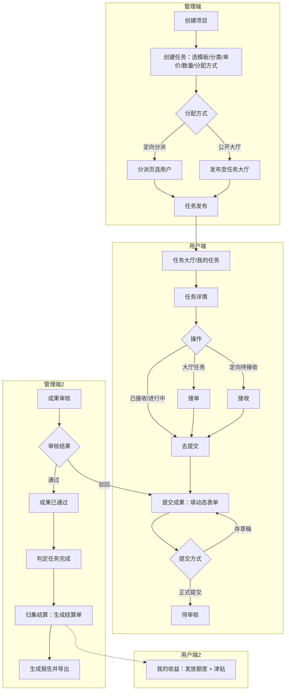
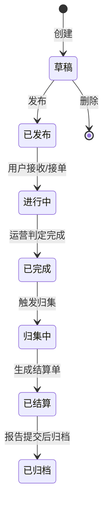
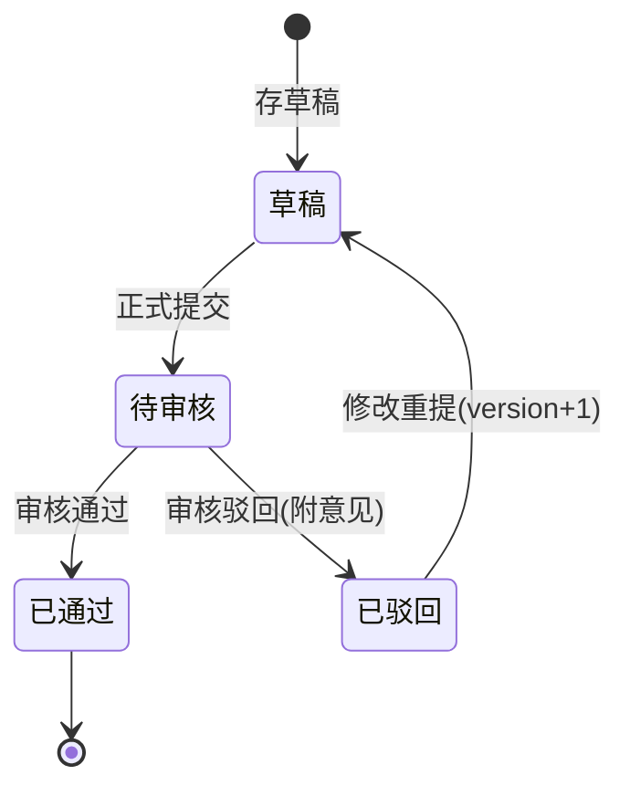

# 医药市场管理服务平台 —— 前端体验重构落地说明

| 项目 | 内容 |
|---|---|
| 版本 | v1.0 |
| 日期 | 2026-10-23 |
| 关联文档 | `01-PRD-产品需求文档.md`、`03-流程与状态流转.md`、`04-前端交互与视觉设计文档.md`、`design-system/default/MASTER.md` |
| 覆盖端 | `frontend/web`（运营平台）、`frontend/app`（C 端小程序） |

> 本文档是任务 9「优化两端前端页面设计与操作流程」的**落地说明**，记录页面职责、路由关系、状态与可用操作、关键路径连贯化后的最终形态，以及遗留的缺接口清单。

---

## 0. 一句话结论

以「任务流」为主干，把两端拉齐为**一套语义令牌 + 一份状态映射 + 一条连贯链路**：补齐小程序「任务详情」页，把「接单/接收/去提交」收敛到详情页；`my-earnings` 语义对齐后端（发放额度 + 津贴 + 顺延提示）；管理端任务页升级为流程枢纽（分派/结算单跨页跳转）；两端空态/错误态/引导统一为「邀请行动 + 可恢复」。

---

## 1. 统一设计令牌落地

- **MASTER.md**：`design-system/default/MASTER.md`，定义两端共用语义色（primary `#4080FF` / success `#22C55E` / warning `#F59E0B` / danger `#EF4444` / info `#64748B`）、状态色统一规则、字体/间距/圆角/图标规范、交互反馈契约。
- **Web**：状态映射唯一真值源 `frontend/web/src/api/module_market/constants.ts`（沿用，已是统一映射）。
- **App**：**新增** `frontend/app/src/constants/market.constant.ts`（与 Web 同文案同语义色），并从 `constants/index.ts` 统一导出。
- **落地约束**：上游主题文件（`_fa-tokens.scss`/`tailwind.css`/`theme.scss`/`uni.scss`/`theme.json`/`uno.config.ts` 等）**不修改**；两端通过语义类型（primary/success/warning/danger/info）对齐。

---

## 2. 两端页面结构说明

### 2.1 管理端（`frontend/web`，路由由后端菜单动态生成）

| 页面 | 路由名 | 职责 | 关键状态 | 可用操作 | 跨页出口 |
|---|---|---|---|---|---|
| 项目 | `MarketProject` | 对外交付单元，任务多对多归集 | DRAFT/IN_PROGRESS/COMPLETED/CLOSED | 新增/编辑/删除/详情、开始进行、判定完成、归档关闭 | — |
| 任务 | `MarketTask` | **流程枢纽**：创建/发布/完成/归集 | DRAFT→PUBLISHED→IN_PROGRESS→COMPLETED→SETTLING→SETTLED→ARCHIVED | DRAFT：编辑/发布/删除；PUBLISHED·IN_PROGRESS：分派/判定完成；COMPLETED：归集结算；SETTLING·SETTLED：结算单 | → 分派页（task_id）、→ 结算页（task_id） |
| 任务类型 | `MarketTaskType` | 计价项维护（绑定模板 form_schema） | — | 新增/编辑/删除/详情 | — |
| 分派 | `MarketAssignment` | 定向分派/撤销 | PENDING/ACCEPTED/SUBMITTING/SUBMITTED/REVIEWED/SETTLED | 批量分派、撤销（仅 PENDING） | ← 任务页（task_id 预填） |
| 成果审核 | `MarketSubmission` | 通过/驳回（附意见） | DRAFT/PENDING/APPROVED/REJECTED | 详情、审核（仅 PENDING，驳回必填意见） | — |
| 结算 | `MarketSettlement` | 结算单查看/确认 | PENDING/CALCULATED/CONFIRMED/REPORTED/PAID | 详情 | ← 任务页（task_id 预填） |
| 报告 | `MarketReport` | 打包生成/导出 | DRAFT/GENERATED/SUBMITTED | 生成报告、详情 | — |
| 发放 | `MarketPayout` | 每月发放额度配置 | enabled 布尔 | 配置发放额度、发放情况 | — |
| 机构/公司 | `MarketInstitution`/`MarketCompany` | 主数据 | 启用/停用 | CRUD | — |

### 2.2 用户端（`frontend/app`，路由 `pages.json`）

| 页面 | 路由名 | 路径 | 职责 | 入口 | 出口 |
|---|---|---|---|---|---|
| 任务大厅 | `market-task-hall` | `subPages/module_market/task-hall` | 公开任务浏览（定额显示剩余名额） | 工作台 | 任务详情（task_id） |
| 我的任务 | `market-my-task` | `subPages/module_market/my-task` | 已接/定向任务，6 档状态 Tab | 工作台、任务大厅 | 任务详情（assignment_id） |
| 任务详情 | `market-task-detail` | `subPages/module_market/task-detail`（**新增**） | 任务说明/单价/标准/执行数量 + 接单/接收/去提交 | 任务大厅、我的任务 | 提交成果（assignment_id） |
| 提交成果 | `market-submission-form` | `subPages/module_market/submission-form` | 动态采集表单 + 存草稿/正式提交 | 任务详情 | 我的任务（提交后回跳） |
| 我的收益 | `market-my-earnings` | `subPages/module_market/my-earnings` | 发放额度 + 津贴余额 + 津贴明细（顺延提示） | 工作台 | — |

---

## 3. 状态 → 可用操作映射表（两端一致）

| 状态 | 文案 | 色型 | 用户端可用操作 | 管理端可用操作 |
|---|---|---|---|---|
| 任务 DRAFT | 草稿 | info | — | 编辑 / 发布 / 删除 |
| 任务 PUBLISHED | 已发布 | primary | 大厅接单（open）/ 接收（direct） | 分派 / 判定完成 |
| 任务 IN_PROGRESS | 进行中 | warning | 去提交 | 分派 / 判定完成 |
| 任务 COMPLETED | 已完成 | primary | 去提交（已接收者） | 归集结算 |
| 任务 SETTLING | 归集中 | warning | — | 结算单 |
| 任务 SETTLED | 已结算 | success | 查看收益 | 结算单 |
| 任务 ARCHIVED | 已归档 | info | — | — |
| 分派 PENDING | 待接收 | info | 接收 | 撤销 |
| 分派 ACCEPTED | 已接收 | primary | 去提交 | — |
| 分派 SUBMITTING | 进行中 | warning | 去提交 | — |
| 分派 SUBMITTED | 已提交 | warning | 去提交（驳回重提） | — |
| 分派 REVIEWED | 已审核 | success | 去提交 | — |
| 分派 SETTLED | 已结算 | success | 查看收益 | — |
| 成果 DRAFT | 草稿 | info | 继续编辑 / 提交 | — |
| 成果 PENDING | 待审核 | warning | 查看 | 审核（通过/驳回） |
| 成果 APPROVED | 已通过 | success | 查看 | — |
| 成果 REJECTED | 已驳回 | danger | 修改重提（version+1） | — |
| 津贴 PENDING | 待发放 | warning | 查看顺延提示 | — |
| 津贴 PAID | 已发放 | success | — | — |

---

## 4. 关键任务路径（连贯化后）

### 4.1 管理端主路径（10 步）

1. 登录 → 工作台首页（待办：待审核成果 / 待分派 / 待结算）
2. 主数据：机构管理（医院/药店/商业公司）→ 公司管理（医药公司）
3. 任务类型：9 类模板 / 44 计价项 / form_schema
4. 项目创建 → 任务多对多归集
5. 任务创建：选类型 → 周期/单价/标准/数量 → 分类 → 分配方式
6. 任务发布 + 分派：定向分派（选用户/批量/撤销）或公开大厅 —— **任务页「分派」跨页跳转**
7. 成果审核：列表 → 通过/驳回（附意见）→ 批量审核
8. 归集结算：任务「判定完成」→「归集结算」→ 结算单（**任务页「结算单」跨页跳转**）
9. 报告：按服务项目/任务类型生成 → 导出
10. 发放额度配置

**入口 → 操作 → 反馈 → 下一站（连贯说明）**：

| 步骤 | 入口 | 操作 | 状态反馈 | 下一站 |
|---|---|---|---|---|
| 发布 | 任务列表行「发布」 | 确认弹窗 → publishTask | 成功 toast「已发布」+ 状态刷新为「已发布」 | 「分派」按钮 → 分派页（task_id 预填）或公开大厅 |
| 分派 | 任务行「分派」 | 跳分派页（task_id 预填）→ 批量选用户 | 成功 toast「分派成功」+ 列表刷新 | 用户端「我的任务」 |
| 审核 | 成果审核列表「审核」 | 详情回显 → 通过/驳回（驳回必填意见） | 成功 toast「已通过/已驳回」 | 用户端通知 |
| 归集 | 任务行「归集结算」 | 确认弹窗 → settleTask | 成功 toast「归集结算成功」+ 状态「已结算」 | 「结算单」按钮 → 结算页 |
| 报告 | 报告列表「生成报告」 | 选公司+周期 → generateReport | 成功 toast「报告生成成功」+ 列表刷新 | 报告详情 → 导出 |

### 4.2 用户端主路径（8 步）

1. 微信登录 → 首页/工作台（tabbar）
2. 任务大厅：浏览 → 点击卡片进详情
3. 我的任务：6 档状态 Tab → 点击卡片进详情
4. 任务详情（**新增**）：任务说明/单价/标准/执行数量 → 接单 / 接收 / 去提交
5. 成果提交：动态表单 → 存草稿 / 正式提交
6. 提交状态：待审核 / 通过 / 驳回（驳回显示意见 → 一键重提）
7. 我的收益：发放额度 / 津贴余额（顺延提示）/ 津贴明细
8. 个人中心：资料 / 通知 / 工单

**入口 → 操作 → 反馈 → 下一站**：

| 步骤 | 入口 | 操作 | 状态反馈 | 下一站 |
|---|---|---|---|---|
| 接单 | 任务详情「接单」 | 确认弹窗 → claimTask | 成功 toast「已接单」，名额不足 toast「名额已满」 | 详情页切换为「去提交」 |
| 接收 | 任务详情「接收」 | acceptAssignment | 成功 toast「已接收」 | 详情页切换为「去提交」 |
| 提交 | 任务详情「去提交」 | 详情 → submission-form（assignment_id 现取 schema） | 提交中 loading；成功 toast「已提交」/「已存草稿」 | **回跳「我的任务」**（列表刷新高亮最新状态） |
| 驳回重提 | 我的任务 → 详情 → 去提交 | 表单回显历史 → 修改 → 提交 | 成功 toast「已提交」+ version+1 | 我的任务 |

---

## 5. 两端连贯操作流程图

### 5.1 全链路 flowchart（任务发布 → 接收 → 提交 → 审核 → 归集 → 结算 → 报告）

### 5.2 任务状态机（管理端任务详情时间线语义）

### 5.3 成果状态机（驳回重提）

---

## 6. 缺接口清单（本次未造，留待确认）

> 按任务要求「不引入新后端接口，缺接口先列清单」。以下缺口已用**现有列表接口**降级实现，但存在取舍，建议后续补齐：

| # | 缺口 | 现状降级 | 建议新增 |
|---|---|---|---|
| 1 | 小程序无「任务单详情」接口（`GET /market/mini/tasks/{id}`） | 任务详情页从 `GET /market/mini/tasks` 列表按 id 查找 | `GET /market/mini/tasks/{id}` |
| 2 | 小程序无「分派单详情」接口（`GET /market/mini/assignments/{id}`） | 详情页/提交页从 `GET /market/mini/assignments` 列表按 id 查找 | `GET /market/mini/assignments/{id}` |
| 3 | 成果审核列表无 `task_id` 筛选（`SubmissionQueryParam` 缺 task_id） | 管理端「任务 → 审核」跨页跳转暂缺（无法按任务预填成果） | `SubmissionQueryParam` 增 `task_id` |
| 4 | 结算→报告跨页跳转缺 `company_id` 上下文（结算单不携带委托公司） | 报告页手动选公司+周期 | 结算单出参补 `company_id` |
| 5 | `my_payout` 只返回「发放额度+津贴」，不含「应发/实发」（属结算单字段） | 我的收益页按后端实际字段展示 | 已于 2026-11-02 扩展为按月视图（`MyPayoutOutSchema`：应发/实发/期初/期末 + 该期结算单明细），见 `specs/market/payout` 的「C 端按月视图」 |

---

## 7. 落地文件清单

### 新增
- `design-system/default/MASTER.md`
- `frontend/app/src/constants/market.constant.ts`
- `frontend/app/src/subPages/module_market/task-detail/index.vue`
- `docs/05-前端体验重构落地说明.md`（本文档）

### 修改（均属市场域项目新增部分，未改上游）
- `frontend/app/src/constants/index.ts`（导出 market.constant）
- `frontend/app/src/api/module_market/index.ts`（TaskTypeItem 接口补 service_type/exec_standard 等）
- `frontend/app/src/locales/langs/{zh,en}.json`（market 段补词条）
- `frontend/app/src/pages.json`（新增 task-detail 路由；my-earnings 标题改「我的收益」）
- `frontend/app/src/subPages/module_market/{task-hall,my-task,submission-form,my-earnings}/index.vue`（统一状态映射、补详情入口、修 Tab 语义、提交回跳）
- `frontend/web/src/views/module_market/task/index.vue`（流程枢纽：分派/结算单跨页跳转 + 流程提示条）
- `frontend/web/src/views/module_market/{assignment,settlement}/index.vue`（读取 task_id 预填筛选）
