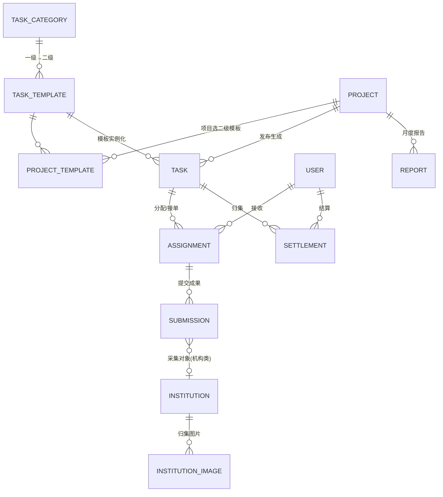

# 医药市场管理服务平台 —— 任务模块重新设计

| 项目 | 内容 |
|---|---|
| 版本 | v2.0（重新设计，不兼容 v1.x） |
| 日期 | 2026-10-28 |
| 关联文档 | `01-PRD`、`02-系统设计`、`03-流程与状态流转`、`04-前端交互`、`05-前端落地` |
| 性质 | **推倒重来**，废弃 v1.x 的 `task_type(44计价项)/template(9)/service_item(37)` 三层模型，不做兼容 |

> 本文档依据 `docs/materials/任务/`（6 个药品示例任务目录）与 `docs/重庆-省平台-市场管理-项目任务清单.xlsx` 重新设计，替代 `01/02/03` 中与任务配置、层级、周期相关的章节。

---

## 1. 为什么要重做（v1.x 的缺陷）

对照真实素材与任务清单，v1.x 设计存在以下结构性缺陷：

| # | 缺陷 | v1.x 现状 | 真实素材反映 |
|---|---|---|---|
| F1 | **层级混乱、三层揉成一层** | `market_task_type` 用 44 个计价项承载「类型/项目/任务」三级，`service_type/service_item/service_task` 三个字符串字段硬编码 | 素材是**两级**（`市场机构管理` → `等级医院管理`），`配送协调/库存盘点/价格核查/竞品调研/销售对账` 是采集表内部的**多行子表（工作区）**，不是独立任务层级 |
| F2 | **计价粒度错位** | 单价挂在 44 计价项上（每个子表一项） | 单价挂在**二级任务**上（`等级医院管理`=2000 元/月/家），一个二级任务内多个工作区共享同一单价 |
| F3 | **任务设计散落在多张表/多个字段** | form_schema 挂 `template`、单价挂 `task_type`、执行标准挂 `task_type.exec_standard`、去重挂 `dedup_rule` | 一个二级任务的全部设计（表单 + 单价 + 执行标准 + 执行人要求 + 提交/去重规则）应当**聚合为一份 JSONB 配置**，由 Pydantic 权威定义 |
| F4 | **项目与任务命名脱节** | `market_task.name` 与项目无关联，C 端看不到「谁家发布的」 | C 端看到的是 `一心坦-等级医院管理`、`心先安-等级医院管理`（**项目名 + 二级任务名**） |
| F5 | **无「周期 + 每月报告」语义** | 任务只有 `period`（自然月字符串），报告按「服务项目×周期」一次性生成 | 任务发布即设**周期（如一年）**，周期内 C 端**每月重复提交成果**，且**每月**聚合生成报告提交甲方 |
| F6 | **对外价目/对内计价两套割裂** | `service_item`(37) 与 `task_type`(44) 独立两套、`service_item_task` 映射 | 结算单只有一套「类型/任务/单位/单价/执行标准」，对外「服务项目结算单」的 37 项实为同一批任务的**甲方口径汇总**，二期再做，一期不落地 |
| F7 | **后台 10+ 模块割裂** | `company/institution/task/task_type/template/project/assignment/submission/settlement/report/service_item/payout/quota` 13 个模块 | 后台只需 **4 个模块**：项目管理、任务管理、发放管理、机构管理 |

---

## 2. 任务目录与清单分析（两级结构）

### 2.1 目录示例（`docs/materials/任务/玄狐&{药品}任务（示例）`）

每个药品（一心坦/心先安/奥康泽/倍稳/宜利宝/慈丹胶囊）对应一个**项目**，目录结构为**两级 + 机构实例**：

```
{药品}任务/
├── 1.市场机构管理/                    ← 一级分类
│   ├── 2.1.等级医院管理/              ← 二级任务
│   │   └── 重庆市xxx医院/xx月/        ← 采集对象(机构) × 月份
│   │       ├── 等级医院管理-数据采集表-配送协调.xlsx   ← 工作区(多行子表)
│   │       ├── 等级医院管理-数据采集表-竞品调研.xlsx
│   │       ├── 等级医院管理-数据采集表-库存盘点.xlsx
│   │       ├── 等级医院管理-数据采集表-配送协调.xlsx
│   │       └── 等级医院管理-数据采集表-销售对账.xlsx
│   ├── 2.2.基层医疗管理/ … 2.5.商业公司管理/
├── 2.市场档案信息调研/                ← 一级分类
│   └── 3.x.{商业公司/等级医院/基层医疗/民营医疗/零售药店}档案信息调研/  ← 二级任务
│       └── …-数据采集表.xlsx
├── 3.专项调研/                        ← 一级分类
│   └── 3.x.{产品认知度/推荐意愿度/品类洞察度}调研/  ← 二级任务
│       └── …-数据采集表.docx (问卷)
├── 4.会议服务/                        ← 一级分类
│   └── 4.x.{产品培训/商品分销/技能培训}活动/  ← 二级任务
│       └── …-数据采集表.xlsx
└── 任务结算单.xlsx                    ← 月度结算清单
```

**关键结论**：任务层级是**两级**；`配送协调/库存盘点/…` 是二级任务采集表内的**多行子表工作区**（见结算单「等级医院管理→配送协调/库存盘点/价格核查/竞品调研/销售对账」）。

### 2.2 完整二级任务目录（合并目录 + 结算单 + 项目任务清单）

| 一级分类 | 二级任务 | 单位 | 单价 | 执行人员要求 |
|---|---|---|---|---|
| 市场机构管理 | 等级医院管理 | 元/月/家 | 2000 | 临床协调员 |
| 市场机构管理 | 基层医疗管理 | 元/月/家 | 1500 | 临床协调员 |
| 市场机构管理 | 民营医疗管理 | 元/月/家 | 1500 | 临床协调员 |
| 市场机构管理 | 零售药店管理 | 元/月/家 | 1200 | 临床协调员 |
| 市场机构管理 | 商业公司管理 | 元/月/家 | 3000 | 市场推广专员 |
| 市场档案信息调研 | 商业公司档案信息调研 | 元/家/次 | 600 | 市场推广专员 |
| 市场档案信息调研 | 等级医院档案信息调研 | 元/家/次 | 600 | 市场推广专员 |
| 市场档案信息调研 | 基层医疗档案信息调研 | 元/家/次 | 400 | 市场推广专员 |
| 市场档案信息调研 | 民营医疗档案信息调研 | 元/家/次 | 400 | 市场推广专员 |
| 市场档案信息调研 | 零售药店档案信息调研 | 元/家/次 | 300 | 市场推广专员 |
| 专项调研 | 产品认知度调研 | 元/份 | 100 | 临床协调员/市场推广专员 |
| 专项调研 | 推荐意愿度调研 | 元/份 | 100 | 临床协调员/市场推广专员 |
| 专项调研 | 品类洞察度调研 | 元/份 | 50 | 临床协调员/市场推广专员 |
| 专项调研 | 疾病认知度调研 | 元/份 | — | 临床协调员/市场推广专员 |
| 专项调研 | 企业认知度调研 | 元/份 | — | 临床协调员/市场推广专员 |
| 专项调研 | 用药依从性调研 | 元/份 | — | 临床协调员/市场推广专员 |
| 专项调研 | 价格敏感度调研 | 元/份 | — | 临床协调员/市场推广专员 |
| 会议服务 | 产品培训活动 | 元/次 | 实际(票据) | 市场推广专员 |
| 会议服务 | 商品分销活动 | 元/次 | 实际(票据) | 市场推广专员 |
| 会议服务 | 技能培训活动 | 元/次 | 实际(票据) | 市场推广专员 |
| 市场宣传服务 | 产品宣传 | 元/次 | — | 市场推广专员 |
| 市场宣传服务 | 健康科普 | 元/次 | — | 市场推广专员 |

> 注：专项调研的「医务人员调研/非医务人员调研」、宣传服务的「户外宣传/媒介宣传」是模板内部的**执行子模式**（对应不同执行人员要求与频次上限），落到 `TaskConfig.exec_modes`，不单独设层级。

### 2.3 采集对象类型（`subject_type`）

| 类型 | 适用 | 对象 |
|---|---|---|
| `institution` | 市场机构管理、档案信息调研 | 医院/药店/商业公司（机构） |
| `staff` | 专项调研（医务人员） | 医务人员/店员 |
| `patient` | 专项调研（非医务人员） | 患者/非医务人员 |
| `meeting` | 会议服务 | 会议（照片 + 签到表 + 票据） |

---

## 3. 核心设计决策（对应 7 点要求）

### D1 任务配置 JSONB + Pydantic 权威定义

二级任务的**全部设计**聚合为 `task_template.config`（JSONB），由 Pydantic `TaskConfig` 定义。前端 TS 类型只对齐、不做定义源。

```python
# backend/app/modules/market/task/config.py
from pydantic import BaseModel, Field
from decimal import Decimal
from typing import Literal
from app.modules.market.form_schema import FormSchemaField

class ExecMode(BaseModel):
    """执行子模式（如 医务人员调研 / 非医务人员调研；户外宣传 / 媒介宣传）。"""
    code: str                       # staff / patient / outdoor / media
    name: str                       # 医务人员调研 / 非医务人员调研 …
    executor: str | None = None     # 临床协调员 / 市场推广专员
    max_per_month: int | None = None  # 单月频次上限
    unit: str | None = None
    price: Decimal | None = None

class SubmitRule(BaseModel):
    """提交规则。"""
    cadence: Literal["monthly", "once", "unlimited"] = "monthly"  # 周期内重复提交节奏
    max_per_day: int | None = None    # 单日上限（如 单人/单日 ≤2 家）
    dedup: str | None = None          # 去重约束（如 单月/单家 ≤1 次）

class TaskConfig(BaseModel):
    """二级任务设计配置（JSONB 宿主，Pydantic 权威定义）。"""
    subject_type: Literal["institution", "staff", "patient", "meeting"]
    unit: str                                   # 元/月/家、元/家/次、元/份、元/次
    pricing_mode: Literal["fixed", "actual"]     # fixed 固定单价 / actual 按票据
    price: Decimal | None = None                 # fixed 模式单价
    exec_standard: str | None = None             # 执行标准（多行）
    executor_requirement: str | None = None      # 默认执行人员要求
    submit_rule: SubmitRule
    exec_modes: list[ExecMode] | None = None     # 执行子模式
    form_schema: list[FormSchemaField]           # 采集表单（含 section/table/image/file）
    report_required: bool = True                 # 是否需月度报告
```

### D2 两级任务层级

- **一级 `task_category`**：市场机构管理 / 市场档案信息调研 / 专项调研 / 会议服务 / 市场宣传服务。
- **二级 `task_template`**：见 §2.2，共 22 个模板，绑定一个一级分类，`config` JSONB 承载设计。

### D3 添加项目时选择一级、二级

`project` 创建时，运营选择**一级分类 + 二级模板**（可多选，也可空）。选中的模板通过 `project_template` 关联；发布项目时，按所选模板**批量生成任务实例**。

### D4 C 端任务名 = 项目名 + 二级任务名

任务实例的 `name` 自动生成为 `{项目名}-{二级任务名}`（如 `一心坦-等级医院管理`），C 端任务大厅/我的任务直接展示该名，无需二次拼装。

### D5 周期 + 周期内每月重复提交 + 每月报告

- `project.period`：项目周期（如 `2026`，全年 / 一年）。
- 任务实例继承项目周期；周期内 C 端用户**每月**提交成果（按 `SubmitRule` 控制频次与去重）。
- **每月**按「项目 × 二级任务」聚合当月审核通过的成果，生成 `report`（月度报告），提交给项目发布方（医药公司）。

### D6 从「项目任务清单」的 TO C 任务制作任务模板

`task_template` 种子直接由 `重庆-省平台-市场管理-项目任务清单.xlsx` 的 **TO C 任务**列生成（§2.2 的 22 项）。发布项目时可选择关联 ToC 任务模板，也可不选。

### D7 后台收敛为 4 个模块

| 后台模块 | 承载内容 | 对应后端模块 |
|---|---|---|
| 项目管理 | 添加项目（选一级/二级）、报告管理 | `project` |
| 任务管理 | 任务发布、任务分配、任务审核 | `task`（含 category/template/assignment/submission） |
| 发放管理 | 结算管理 | `payout`（含 settlement） |
| 机构管理 | C 端对机构提交的图片等信息归集 | `institution` |

---

## 4. 数据模型

### 4.1 ER 总览



### 4.2 表设计（PG 18，JSON 列用 JSONB，主键 BigInteger）

> 约定：主键 `id BigInteger`；审计字段复用 `UserMixin`；任务设计与表单数据用 JSONB。

#### `market_task_category`（一级任务分类）

| 字段 | 类型 | 说明 |
|---|---|---|
| code | varchar(64) unique | 唯一编码，如 `market_institution` |
| name | varchar(128) | 分类名，如「市场机构管理」 |
| sort | smallint | 排序 |
| description | text | 说明 |

#### `market_task_template`（二级任务模板，ToC 任务）

| 字段 | 类型 | 说明 |
|---|---|---|
| code | varchar(64) unique | 唯一编码，如 `grade_hospital_manage` |
| name | varchar(128) | 二级任务名，如「等级医院管理」 |
| category_id | bigint FK | 一级分类 `market_task_category.id` |
| config | jsonb | **任务设计配置**（`TaskConfig`，含 unit/price/pricing_mode/exec_standard/executor/submit_rule/exec_modes/form_schema） |
| enabled | bool | 是否启用 |

#### `market_project`（项目，对外/甲方）

| 字段 | 类型 | 说明 |
|---|---|---|
| code | varchar(64) unique | 项目编码 |
| name | varchar(128) | 项目名（药品名，如「一心坦」） |
| company_id | bigint FK | 委托方（医药公司，甲方） |
| period | varchar(16) | 项目周期（如 `2026`，一年） |
| status | varchar(32) | 草稿/进行中/已完成/已关闭 |
| publisher_id | bigint | 发布人 |

#### `market_project_template`（项目—二级模板关联，多对多）

| 字段 | 类型 | 说明 |
|---|---|---|
| project_id | bigint FK | 项目 |
| template_id | bigint FK | 二级模板 |
| （唯一约束） | — | `unique(project_id, template_id)` |

#### `market_task`（任务实例，对内执行单元）

| 字段 | 类型 | 说明 |
|---|---|---|
| task_no | varchar(32) unique | 运行期流水号 |
| project_id | bigint FK | 归属项目 |
| template_id | bigint FK | 二级模板 |
| name | varchar(256) | **C 端显示名 = `{项目}-{二级任务}`** |
| period | varchar(16) | 继承项目周期 |
| assign_mode | varchar(16) | `direct` 定向 / `open` 大厅 |
| status | varchar(32) | 见状态机 |
| publisher_id / published_at | — | 发布人/时间 |

> 单价/执行标准/表单结构不再冗余到 task，运行时从 `template.config` 读取；如需对单任务覆盖单价，可加 `unit_price_override`（numeric，可空）。

#### `market_assignment`（任务分配/接收）

| 字段 | 类型 | 说明 |
|---|---|---|
| task_id | bigint FK | 任务 |
| user_id | bigint FK | C 端用户 |
| source | varchar(16) | `assigned` / `claimed` |
| status | varchar(32) | 待接收/已接收/进行中/已提交/已审核/已结算 |

#### `market_submission`（成果提交，每月重复）

| 字段 | 类型 | 说明 |
|---|---|---|
| assignment_id | bigint FK | 任务实例 |
| user_id | bigint FK | 提交人 |
| subject_type | varchar(32) | 采集对象类型 |
| institution_id | bigint FK（可空） | 机构（institution 类） |
| subject_name | varchar(128) | 对象名称（staff/patient/meeting） |
| period | varchar(16) | 提交月份（如 `2026-03`） |
| form_data | jsonb | 采集表单数据（含多行子表、图片/附件 URL） |
| status / version | — | 草稿/待审核/通过/驳回；版本 |
| reviewer_id / review_comment / reviewed_at | — | 审核信息 |

> 周期性约束：`unique(assignment_id, user_id, period, subject_type, subject_key)` 控制「单月单对象一次」（subject_key = institution_id 或 subject_name）。

#### `market_report`（月度报告，提交甲方）

| 字段 | 类型 | 说明 |
|---|---|---|
| project_id | bigint FK | 项目 |
| template_id | bigint FK（可空） | 二级任务 |
| period | varchar(16) | 报告月份（如 `2026-03`） |
| summary | jsonb | 当月完成量/金额汇总 |
| attachment | varchar | 报告附件路径 |
| status | varchar(32) | 草稿/已生成/已提交 |

#### `market_settlement` / `market_settlement_item`（结算单）

| 表 | 关键字段 | 说明 |
|---|---|---|
| settlement | task_id, user_id, period, qty, payable_amount, status | 月度归集头 |
| settlement_item | settlement_id, unit, price, qty, amount | 结算明细 |

#### `market_payout_config` / `market_allowance` / `market_allowance_detail`（发放 + 津贴）

沿用 v1.x 结构（每月发放额度 / 津贴账户 / 津贴明细），归属 `payout` 模块。

#### `market_institution` / `market_institution_image`（机构 + 图片归集）

| 表 | 关键字段 | 说明 |
|---|---|---|
| institution | name, type, region, … | 机构主数据（医院/药店/商业公司） |
| institution_image | institution_id, submission_id, image_url, category, uploaded_by, period | **C 端提交的图片归集**（门头照/内景照等，按机构聚合） |

---

## 5. 模块与目录规划

后端域包收敛为 4 个业务模块 + 共享件：

```
backend/app/modules/market/
├── project/          # 项目管理：项目 + 项目-模板关联 + 报告
├── task/             # 任务管理：一级分类 + 二级模板 + 任务实例 + 分配 + 成果审核
├── payout/           # 发放管理：结算 + 发放额度 + 津贴
├── institution/      # 机构管理：机构 + 图片归集
├── form_schema.py    # 共享：FormSchemaField
├── enums.py          # 共享：状态机/枚举
├── base.py           # 共享：MarketCRUDBase
├── models.py         # 共享：模型统一注册入口
├── mini_controller.py # 共享：C 端接口
└── plugin.toml
```

前端对齐（4 个后台菜单 + C 端页面）：

```
frontend/web/src/views/module_market/
├── project/          # 项目管理（添加项目 + 报告管理）
├── task/             # 任务管理（发布 + 分配 + 审核）
├── payout/           # 发放管理（结算管理）
└── institution/      # 机构管理（图片归集）
```

---

## 6. 状态机

| 实体 | 状态流转 |
|---|---|
| 项目 | `DRAFT → IN_PROGRESS → COMPLETED → CLOSED` |
| 任务 | `DRAFT → PUBLISHED → IN_PROGRESS → COMPLETED → SETTLED → ARCHIVED` |
| 分配 | `PENDING → ACCEPTED → SUBMITTING → SUBMITTED → SETTLED`（每月可 `SUBMITTING→SUBMITTED` 循环） |
| 成果 | `DRAFT → PENDING → APPROVED / REJECTED(→DRAFT 重提)` |
| 报告 | `DRAFT → GENERATED → SUBMITTED` |
| 结算 | `PENDING → CALCULATED → CONFIRMED → REPORTED` |

---

## 7. API 设计（摘要）

| 端 | 方法 | 路径 | 说明 |
|---|---|---|---|
| 运营 | POST | `/market/categories` | 维护一级分类 |
| 运营 | POST | `/market/templates` | 维护二级模板（ToC 任务，含 config） |
| 运营 | POST | `/market/projects` | 创建项目（选一级/二级模板） |
| 运营 | POST | `/market/projects/{id}/templates` | 项目关联/调整二级模板 |
| 运营 | POST | `/market/projects/{id}/publish` | 发布项目 → 按模板批量生成任务 |
| 运营 | POST | `/market/tasks/{id}/publish` | 发布任务（定向/大厅） |
| 运营 | POST | `/market/assignments` | 定向分派 |
| 运营 | GET | `/market/submissions?task_id=` | 审核列表 |
| 运营 | POST | `/market/submissions/{id}/review` | 通过/驳回 |
| 运营 | POST | `/market/reports` | 生成月度报告 |
| 运营 | POST | `/market/tasks/{id}/settle` | 触发月度归集结算 |
| 运营 | PUT | `/market/payout/{user_id}` | 配置每月发放额度 |
| 运营 | GET | `/market/institutions/{id}/images` | 机构图片归集查看 |
| 小程序 | GET | `/market/mini/tasks` | 任务大厅（显示 `{项目}-{二级任务}`） |
| 小程序 | GET | `/market/mini/tasks/{id}` | 任务单详情 |
| 小程序 | POST | `/market/mini/assignments/{id}/accept` | 接收任务 |
| 小程序 | GET | `/market/mini/assignments/{id}` | 分派单详情 |
| 小程序 | POST | `/market/mini/submissions` | 提交成果（含图片/附件） |
| 小程序 | GET | `/market/mini/payout` | 我的发放额度/津贴 |

---

## 8. 实施计划（分模块并行）

| 批次 | 模块 | 内容 |
|---|---|---|
| 0（先决） | 共享件 | `enums.py`/`form_schema.py`/`config.py`/`models.py`/`routers.py` + 种子（5 一级 + 22 二级 + form_schema） |
| 1 | `project` | 项目 + 项目-模板关联 + 发布生成任务 + 报告 |
| 2 | `task` | 分类/模板 CRUD + 任务实例 + 分配 + 成果审核 |
| 3 | `payout` | 结算 + 发放额度 + 津贴 |
| 4 | `institution` | 机构主数据 + 图片归集 |
| 5 | 前端 | web 4 菜单 + app C 端页面 + 菜单 seed |

> 落地顺序：批次 0 由主 Agent 先做（共享件是并行前提），批次 1–4 用多 Agent 并行（各自独立目录，无文件冲突），批次 5 在批次 1–4 完成后并行。
